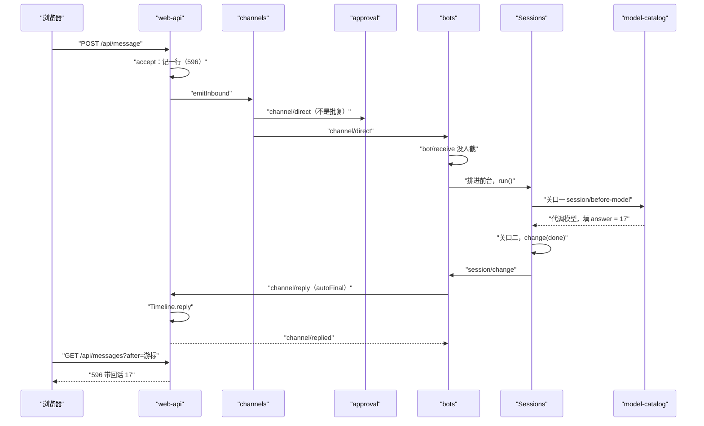

# 第十一块：一条最简单的网页消息从头到尾

读完这一块，你能讲清楚 4 件事：

1. 在网页上点「发送」以后，这句话先到了哪个插件、变成了什么样子。
2. 它怎么被机器人「周小灵」认领，进了哪一场会话、怎么开跑的。
3. 骨架的 `Resources`、`Sessions`、`Tools` 三件在这一句里各干了什么；模型到底是谁调的。
4. 回复「17」怎么回到网页上显示出来。

全程只跟一条真实的消息：在主网页给周小灵发 `8+9等于几？只回数字`（收件号 596）。它的轨迹画布是 `/tutorial/?canvas=596`，建议边开着它边读。

要先读第一块（骨架、四个关口、挨个问和通知）和第二块（渠道消息、认领、回复和回执）。第九、十块读过更好，这里只走主线，不展开岔路。

> **一句话版**：网页把话 POST 给 `web-api` → `web-api` 存一行、发 `channel/direct` → `bots` 认领、排进周小灵的网页前台、推它跑 → 骨架 `Sessions` 过关口一时 `model-catalog` 代调了模型 → 模型直接答「17」、没调工具 → `bots` 把最后这句经 `channel/reply` 交给 `web-api` → `web-api` 写进收件表 → 网页 1.5 秒一次的轮询拿到它。

## 一图看懂：596 这一条走过的 9 步

手机竖着看，从上往下。左边是轨迹画布上的步号，右边毫秒是从收下这条算起。

```
浏览器 Composer.send
  │ POST /api/message
  ▼
①  0ms web-api 收下，记一行
     发 channel/direct
     （approval 看不是“同意 N”）
     bots 认领 → 排进前台 → 开跑
②  54ms sessions 状态 running
     记下用户这句话
③  89ms bots 发 memory/front-message
④  96ms 关口一 before-model
     9 个插件挨个改请求
⑤ 119ms bots 拼最近往来
     ……model-catalog 排最后，
     自己调模型，等了 3.3 秒
⑥ 127ms web-api 把这行绑上会话
⑦3453ms 骨架：已经有回答，不再调
     关口二 after-model
     记下回答，状态 done
⑧3495ms bots 没调回复工具
     把最后的话发出去
⑨3511ms web-api 收件表追加回话
  │
  ▼
浏览器 1.5 秒一轮的增量拉取
拿到 "17"，画到气泡里
```

整条 3.5 秒，3.3 秒花在等模型。下面分四段讲。

## 阶段一：浏览器发出去，web-api 接住

**一句话**：网页只做一件事，把输入框里的话 POST 到 `/api/message`。后端是 `web-api` 插件接，它是一个渠道（渠道名 `http`）。

```tsx
// web/src/Chat/Composer.tsx
340	    const body: Record<string, unknown> = {
341	      text: finalText,
342	      bot: props.bot,
343	      from: 'web',
344	      uploads: attachments.uploadIds,
345	      session,
346	      reply_to: props.reply?.id,
347	    };
348	    if (props.view) {
349	      body['view'] = props.view;
350	    }
351	    //M 把整理好的消息载荷发往发送接口，成功则清空输入区，失败则给出提示。
352	    api.sendJson<{ id: number; file: string }>('/api/message', 'POST', body).then(
```

- `session` 一般是空的：没在输入框上方选「接着哪场会话」，就交给后端自己找前台。
- `from: 'web'` 只是来源标记，身份不靠它。

**后端入口**只有一行，真正干活的是 `accept`：

```ts
// src7/plugins/web-api/index.ts
295	    //M 登记网页发话入口，交给渠道入站逻辑统一校验和分派。
296	    scope.post<{ Body: unknown }>('/api/message', async (request) => {
297	      //M 来源标记取自 HTTP 钩子，正文里的身份字段不会进入可信快照。
298	      const verified = this.ctx.http.isVerified(request);
299	      return this.accept(request.body, verified);
300	    });
```

`isVerified` 是 `http` 插件早就核过的：本机来的、或带对令牌的，才算本人。正文里写什么身份都不算数。

**`accept` 做三件事**（`web-api/index.ts:387` 起）：

1. 校验一次请求体：`text` 要是字符串，机器人要在配置里，选了会话要属于这个机器人。
2. 先在自己的收件表 `web_messages` 里记一行，拿到收件号（就是 596）：

```ts
// src7/plugins/web-api/index.ts
482	    //M 先写入网页消息并取收件编号，供分派和回话定位。
483	    const id = this.timeline.insert(newMessage);
```

3. 定路由：网页是一对一的渠道，写上 `autoFinal`。记住这个开关，阶段四要用：

```ts
// src7/plugins/web-api/index.ts
493	    const routing: protocol.ChannelRouting = {
494	      autoFinal: true,
495	    };
```

**然后包成标准消息、发出去**。`emitChannelMessage` 把它拼成一个 `ChannelMessage`：渠道 `http`、聊天 `http:本机`、角色 `owner`、目标机器人 `['周小灵']`。再交给 `channels` 的 `emitInbound`：

```ts
// src7/plugins/web-api/index.ts
595	    //M 发出 channel/direct（网页是私聊、本人叫机器人）：approval 先看“同意 N”，bots 再认领进会话（前台用 channel_reply 回，几条都追加进回话清单）。
596	    const control: protocol.ChannelMessageControl = { claims: [] };
597	    await protocol.emitInbound(this.ctx, channelMessage, true, control);
598	    if (control.approvalHandled !== true && control.claims.length === 0) {
599	      throw new Error(`机器人 ${wanted} 收到了消息，但前台没有定下进哪场会话`);
600	    }
```

注意 `web-api/index.ts:597` 那行的 `await`：它要等认领的人全部处理完才往下走。下面一行检查：要是谁都没认领、也不是批复，就报错、把刚记的那行删掉，网页提示「没发出去」。

**`emitInbound` 只是分拣**，三选一：

```ts
// src7/plugins/channels/Message.ts
286	  const event = getInboundEvent(message.chatType, called);
287
288	  //M 只听：没叫机器人的话，approval 不看，bots 只记背景或判断要不要接。
289	  if (event === 'channel/listen') {
290	    await ctx.serial('channel/listen', message, control);
291	    return;
292	  }
293
294	  //M 群里叫了机器人：approval 先看批复，bots 认领要回的机器人。
295	  if (event === 'channel/mention') {
296	    await ctx.serial('channel/mention', message, control);
297	    return;
298	  }
299
300	  //M 私聊：approval 先看批复，bots 认领。
301	  await ctx.serial('channel/direct', message, control);
```

网页是私聊，`called` 写的是 `true`，所以走最后一行：`channel/direct`，挨个问。

> 类比：`web-api` 是挂号窗口。登记一张挂号单（收件表一行），盖上「本人、一对一」的章，丢进分诊台的传送带（`channel/direct`）。

## 阶段二：bots 认领，排进前台，推它开跑

`channel/direct` 是「挨个问」，照插件挂上的先后一个个 `await`。这一条依次经过三个插件：

1. **approval 排第一**（`approval/index.ts:456` 用了 `prepend`）：看是不是「同意 3」这种批复。`8+9等于几` 不是，放过。
2. **bots 认领**（下面细讲）。
3. **web-api 自己**也听 `channel/direct`，但开头就判断：是自己渠道发的就不管（`bindClaims`，`web-api/index.ts:272`）。

**bots 对每个目标机器人认领一次**。先算去重键，同一条消息重发时靠它认出来：

```ts
// src7/plugins/bots/index.ts
614	      //M 这条消息对这个机器人的去重键（消息号加机器人名），渠道重发时靠它认出已经收过。
615	      const claimKey = protocol.getClaimKey(message.messageId, botName);
```

**再问一圈 `bot/receive`**：谁要把这条截走？

```ts
// src7/plugins/bots/index.ts
647	      //M 保留每机器人内部兼容关口 bot/receive（relay 转外部助手、tutorial 认关键词、web-api 记别的渠道的消息）。
648	      await this.home.serial('bot/receive', receiveEvent);
649
650	      if (receiveEvent.handled === true) {
651	        claimModule.pushClaim(control, botName, claimKey, 'handled');
652	        continue;
653	      }
```

听 `bot/receive` 的有 relay、tutorial、approval、voice、web-api。这一条谁都没截：

- **relay** 只认带前缀的话（`cc`、`哈基米` 开头）。它的 `pickReceiveSessionKind` 走到第 3 条路，`8+9等于几` 没前缀，交回 `undefined`，relay 不截：

```ts
// src7/plugins/relay/Receive.ts
135	  //M 第 3 条路：其余情况仅在命中助手前缀时进 relay 会话。
136	  if (matchHelperPrefix(helpers, text) !== undefined) return 'relay';
137
138	  return undefined;
```

- **web-api** 的 `onReceive` 只记别的渠道的消息，自己渠道的跳过。
- tutorial 只认快照关键词，approval、voice 也和这条无关。

没人截，就进周小灵的前台：

```ts
// src7/plugins/bots/index.ts
688	      //M 未被其他插件接管 → 按来源范围进该机器人的前台单队列（channel_tool 模式）。话用 incoming.text（理由同上）。
689	      await this.home.frontDesk.claimChannelMessage(bot, message, botOrigin, incoming.text, claimKey, control);
```

**`claimChannelMessage` 定进哪场前台**（`DispatchClaim.ts`）：

```ts
// src7/plugins/bots/DispatchClaim.ts
107	    //M 进哪场前台：指定了就是它；没指定按来源范围（渠道、账号、聊天）找，没有就开。
108	    let picked = target;
109	    if (picked === undefined) {
110	      picked = this.desk.findOrCreateFrontByScope(bot.name, scope, customer);
111	    }
```

按「渠道 + 账号 + 聊天」找：`http` + `local` + `http:本机`。周小灵在网页上本来就有一场前台（会话号 `20261117140757919963`），找到就用它，不新开。

接着把这句包成一个**队列项**排进前台的 `resultQueue`。这时候把阶段一的 `autoFinal` 抄进了这一轮的回复控制：

```ts
// src7/plugins/bots/DispatchClaim.ts
201	    //M 一对一的渠道（网页、命令行、微信）写了 autoFinal：零次回复时直接把最后的话发出去，不跑修复轮。
202	    if (message.routing.autoFinal === true) {
203	      replyControl.autoFinal = true;
204	    }
```

前台闲着，就马上推它：

```ts
// src7/plugins/bots/DispatchClaim.ts
141	    //M channel_tool 首条输入也经同一个 drain 设置 activeKey 与快照后才启动 Session.run。
142	    if (front.row.state !== 'running' && front.row.activeKey === undefined) {
143	      this.queue.drain(front);
144	    }
```

`drain` 取出这一项，走到 `startQueuedUser`：

```ts
// src7/plugins/bots/DispatchResults.ts
933	      //M 回话地址换成这一条话的来源，存库；原话没记进对话的才加进去（延迟接话的已经记过）。
934	      this.home.bots.route(session, said.origin);
935	      session.save();
936	      if (said.alreadyRecorded !== true) {
937	        session.queueUserMessage(said.payload.text);
938	      }
939
940	      //M 推会话跑一轮，不等；回话由 channel_tool 的回复工具发。
941	      void session.run();
```

两个关键动作：

- `queueUserMessage`：把话放进会话的待接收箱（骨架 `Sessions.ts:640`）。
- `void session.run()`：推会话跑，**不等**。

> 为什么轨迹里第 ⑥ 步「绑定会话」排在关口一后面？就因为这个 `void`。`run` 一路同步跑到第一个真正要等的地方（关口一里的插件），才把控制权交回来。这时 `emitInbound` 才返回，`web-api` 才把 596 这行绑上会话号（`Timeline.bindSession`）。

> 类比：分诊台（bots）看挂号单，确认不是来签字的（approval）、不是找外院专家的（relay），就把病人领进周小灵的门诊室（前台），排到第一个，喊一声「下一位」（`run`），自己不在门口等。

## 阶段三：骨架 Sessions 跑主循环

这一段把你读过的三个骨架件串起来。

### 3.1 run：开跑

```ts
// src7/Sessions.ts
581	  async run(): Promise<void> {
582	    //G 已经在转 → return。
583	    if (this.aborter !== undefined) return;
584
585	    //M 备好这一轮的取消开关，状态改成 running，跑循环；不管怎么结束都把开关收掉。
586	    const aborter = new AbortController();
587	    this.aborter = aborter;
588	    this.change('running', '');
589	    try {
590	      await this.loop(aborter.signal);
```

`change('running')` 会存库、发通知 `session/change`。这就是轨迹第 ② 步：bots、relay、context-fit、voice 听到「开始转了」。

### 3.2 loop 第一步：备请求，过关口一

接进排队的话（发 `session/new-message`，第 ② 步后半），备好这一步的请求：

```ts
// src7/Sessions.ts
636	      //M 关口一，调模型之前：备好这一步的请求，交给插件挨个改（session/before-model）。
637	      const request: ChatRequest = {
638	        session: this,
639	        model: this.row.model,
640	        thinking: this.row.thinking,
641	        system: [],
642	        tools: this.ctx.tools.listToolsForSessionKind(this.row.kind),
643	        messages: [...this.row.messages],
644	        signal: modelSignal,
645	      };
646	      //M 经过两个模型关口后接入回答；这一步被取消时，重新从队列取话。
647	      const answer = await this.getStepAnswer(request);
648	      if (answer === undefined || modelSignal.aborted) continue;
```

三个骨架件在这里碰头：

- **Sessions** 给出 `model`、`thinking`、对话副本 `messages`，都来自会话记录 `row`。
- **Tools** 给出 `tools`：按会话种类 `front` 从登记表里挑。

```ts
// src7/Tools.ts
154	  listToolsForSessionKind(kind: string): piAi.Tool[] {
155	    //M 登记表里挑出这种会话能用的，只交出给模型看的定义。
156	    const all = [...this.specs.values()];
157	    const usable = all.filter((spec) => spec.sessionKinds.includes(kind));
158	    return usable.map((spec) => spec.definition);
159	  }
```

- **Resources** 不出现在这几行里，但到处是它：`row` 每次 `save()` 都写进 `Resources` 开的库；机器人配置、人设文件也从它取。

```ts
// src7/Resources.ts
211	    //M 开数据库 data/jmbots7.db（没有就建）；这个服务被拔掉时关。
212	    const dbFile = path.join(this.ensureRuntimeDir('data'), 'jmbots7.db');
213	    this.db = new Database(dbFile, { create: true });
```

然后进 `getStepAnswer`，过**关口一**：

```ts
// src7/Sessions.ts
696	      //M 关口一：插件在这里修改请求，也可以提供现成回答。
697	      await this.ctx.serial('session/before-model', request);
```

轨迹第 ④ 步列出了这一次挨个问到的 9 个插件：bots、relay、memory、file-tools、context-fit、assist、approval、wechat-kefu、model-catalog。前面的往请求里加东西：

- bots 的 `Prompt.ts` 往 `system` 里加基础提示、前台提示、人设 `persona.md`；
- bots 的 `FrontDesk.onRequest` 把最近往来拼进 `messages`（第 ⑤ 步：这一轮 1 条，背景 50 条）；
- bots 的 `ChannelTools` 提醒模型「要回话就调 `channel_reply`」：

```ts
// src7/plugins/bots/ChannelTools.ts
103	    //M channel_tool 模式必须显式调 channel_reply。
104	    if (hasReplyBinding && request.tools.some((tool) => tool.name === 'channel_reply')) {
105	      request.system.push(CHANNEL_REPLY_HINT);
106	    }
```

### 3.3 模型是谁调的：model-catalog 在关口一里代调

**这是最容易看错的地方。** 骨架自己会调 `ctx.sessions.chat`，但这一条它没调：

```ts
// src7/Sessions.ts
710	      //M 采用插件给出的回答，或用本步的信号请求模型。
711	      let answer = request.answer;
712	      if (answer === undefined) {
713	        answer = await this.ctx.sessions.chat(request);
714	      }
```

因为**排在关口一最后的 `model-catalog`** 已经调过了。它的 `Fallback.ts` 在关口一里自己调模型，把结果填进 `request.answer`：

```ts
// src7/plugins/model-catalog/Fallback.ts
213	    //M 先查请求指定的模型是否不在冷却期，不在则优先直接试它。
214	    if (this.cooling(asked) === undefined) {
215	      try {
216	        //M 占并发名额并带着单次限流熔断信号发起请求，成功即填回 request.answer。
217	        request.answer = await this.attempt(request, asked);
```

这样做是为了「换模型」：原模型被限流、上下文超长、上游找不到服务时，它当场换备用模型重试，骨架什么都不用管。

所以轨迹上那 3.3 秒，是 `model-catalog` 在关口一里等 `magpie/workbuddy/deepseek-v4.1-flash` 回答。第 ⑦ 步的标题写「插件已经给了回答，不调模型」，说的就是骨架看到 `request.answer` 已经有了（`Sessions.ts:708` 记的那一行）。

轨迹里的 `step: 13` 也不奇怪：`row.steps` 跨轮累计，这场前台以前已经走过 12 步。

### 3.4 关口二，然后收工

```ts
// src7/Sessions.ts
717	      //M 关口二：插件在回答进入历史前检查或替换回答。
718	      const answered: AnsweredRequest = { ...request, answer };
```

关口二 `session/after-model` 这次**没人听**（轨迹第 ⑦ 步「听」那一栏是空的），回答原样接进对话。

模型回的只有文字「17」，没有工具调用：

```ts
// src7/Sessions.ts
659	      //M 模型没要工具 → 这一轮做完了，它说的就是回给用户的话。
660	      if (calls.length === 0) {
661	        const reply = piAi.contentText(answer.content);
662	        this.change('done', reply);
663	        return;
```

`change('done', '17')`：存库，发 `session/change`。关口三、四（执行工具前后）这一轮根本没走到。

> 类比：护士（关口一的插件们）把病历整理好，最后一位是「转诊专员」model-catalog：它亲自去问医生，医生忙它就换一位。病人只问了一句话，医生说完「17」就结束，不用开检查单（工具）。

## 阶段四：回复怎么回到网页

### 4.1 bots 收尾：模型没调回复工具，替它发

前台是 `channel_tool` 模式：本来要模型自己调 `channel_reply` 才算回话。这一轮模型一次没调，就是「零次回复」。

`session/change` 带着 `done` 到了 bots 的 `DispatchResults.onChange`，走到 `finishChannelFront`。阶段二抄进来的 `autoFinal` 在这里起作用：

```ts
// src7/plugins/bots/DispatchResults.ts
590	    //M 一对一的渠道（autoFinal）零次回复：不跑修复轮，直接把最后的话当 final 发出去，发完再回来收尾。
591	    if (eligibleZeroFallback && control !== undefined && control.autoFinal === true) {
592	      control.reminder = 'used';
593	      front.save();
594	      void this.sendLastWords(front, item, control);
595	      return;
```

一对一的渠道（网页、命令行、微信）不跑「提醒你回话」的修复轮，直接把 `row.reply`（就是「17」）当最终回复发出去。轨迹第 ⑧ 步的标题「这一轮没调回复工具，把最后的话发出去」就是它：

```ts
// src7/plugins/bots/DispatchResults.ts
728	    //M 发 channel/reply 请求，等渠道交回回执（发到了、发了一部分、没收）。
729	    const options = {
730	      replyRequestKey,
731	      replyRoundKey: control.roundKey,
732	      replyIndex,
733	      kind: 'final' as const,
734	    };
735	    //M 自动最终回复沿同一来源和请求键取回真实渠道回执。
736	    const receipt = await protocol.requestTextReply(this.home, snapshot, text, options);
```

### 4.2 channel/reply：请渠道发一条

`requestTextReply` 拼好请求，经一问一答（第四块讲的 `requestEvent`）发 `channel/reply`、等 `channel/replied`：

```ts
// src7/plugins/channels/Reply.ts
194	  const asked = await requestEvents.requestEvent(ctx, 'channel/reply', 'channel/replied', req, options);
195	  if (asked.why === undefined) return asked.reply.receipt;
```

谁接单？`web-api` 构造时用 `registerTextReply` 登记过：渠道名是 `http` 的请求归它（`web-api/index.ts:154`）。`channels` 的公共代码认领后，调 `web-api` 给的直发函数：

```ts
// src7/plugins/channels/TextReply.ts
116	      //M 将正文与可选跨渠道解析地址交由渠道适配器的直发逻辑写出；不交回结果的渠道照旧算已发。
117	      const returned = await adapter.sendDirectText(body, request, targetAddress);
```

### 4.3 web-api 把回话挂到 596 这一行

直发函数是 `replyDirect`。阶段二已经把 596 绑上了会话，这里直接用：

```ts
// src7/plugins/web-api/index.ts
689	    //M 认领时记下了会话：用它（一轮里连发的几条都挂在同一场上）。
690	    if (record.sessionId !== null && this.ctx.sessions.find({ id: record.sessionId })[0] !== undefined) {
691	      const session = this.ctx.sessions.open(record.sessionId);
692	      this.timeline.reply(messageId, session, text);
693	      return;
694	    }
```

`Timeline.reply` 把「17」追加进这一行的回话清单、改状态，写库（轨迹第 ⑨ 步）：

```ts
// src7/plugins/web-api/Timeline.ts
426	    //M 写入整份回话清单与新状态，供轮询和追溯共同读取。
427	    const sql = 'UPDATE web_messages SET replies = ?, session_id = COALESCE(session_id, ?), status = ?, updated_at = ?'
428	      + ' WHERE id = ?';
429	    const replies = JSON.stringify(record.replies);
430	    this.ctx.resources.db.query(sql).run(replies, sessionId, status, now, id);
```

`TextReply` 随后发 `channel/replied` 回执，bots 记下「发到了」，再发 `bot/settled`。`web-api` 听到它，把这一行标成回完（`web-api/index.ts:166`）。

### 4.4 浏览器怎么知道：轮询，不是推送

**后端不往网页推任何东西。** 聊天页每 1.5 秒（`Poll.ts:14`，标签页藏起来时 5 秒）拿上次的游标问一次「有什么变了」：

```ts
// web/src/Chat/useMessages.ts
145	      //M 按上次游标增量拉取新消息或回复变动，若请求期间切换了目标则忽略结果。
146	      const page = await fetchMessagesPage(bot, { after: cursor.current, origin: queryOrigin, channel, chat });
147	      if (generation.current !== mine) return;
148
149	      //M 有新增或更新时直接合并到时间线并推进增量游标。
150	      if (page.messages.length > 0) {
151	        setMessages((old) => timeline.mergeMessages(old, page.messages));
152	      }
```

`GET /api/messages?after=游标` 返回改动过的行，596 带着回话清单回来，网页把「17」画进气泡。

> 类比：挂号窗口（web-api）把医生的话抄进挂号单。病人自己每隔一会儿到窗口看一眼单子（轮询），看到写了字就拿走。

## 对着 canvas=596 边点边读

打开 `/tutorial/?canvas=596`，泳道图上每一格，就是代码里一句 `this.ctx.emit('trace', …)` 或一个事件。对照表：

| 步 | 泳道 | 代码里的出处 |
|---|---|---|
| ① | web-api | `WebApi.accept` 末尾的跟踪（`web-api/index.ts:503`） |
| ② | sessions | `run` 里的 `change('running')`；接话时的 `append` |
| ③ | bots | 前台记下这句给 memory（`FrontDesk.ts:575`） |
| ④ | sessions | 关口一 `session/before-model` |
| ⑤ | bots | `FrontDesk.onRequest` 拼最近往来 |
| ⑥ | web-api | `Timeline.bindSession`（`emitInbound` 返回后） |
| ⑦ | sessions | 骨架看到已有回答；关口二；`change('done')` |
| ⑧ | bots | `Dispatch.sendLastWords` |
| ⑨ | web-api | `Timeline.reply` |

**怎么读**：

- 每一格右边列着「听」的插件。想知道谁在改请求，就看关口一那格的 9 个名字，挨个搜 `session/before-model`。
- 「毫秒」那一列的大跳跃（⑥ 到 ⑦ 的 3.3 秒）就是在等模型。
- 想看某一步当时的变量，点格子看快照（`facts`）：⑦ 里有模型名和 `step`，⑨ 里有回话长度。

轨迹和代码一步不差，是因为画布就是从这些 `trace` 和事件记录里画出来的，不是另外手写的。

## 时序图



## 按这个顺序读源码

1. `web/src/Chat/Composer.tsx:340`：网页拼请求、POST。
2. `src7/plugins/web-api/index.ts:387`：`accept` 校验、记一行、定路由。
3. `src7/plugins/web-api/index.ts:530`：`emitChannelMessage` 拼标准消息、发出。
4. `src7/plugins/channels/Message.ts:280`：`emitInbound` 三选一。
5. `src7/plugins/bots/index.ts:589`：`onChannelMessage` 认领、问 `bot/receive`。
6. `src7/plugins/bots/DispatchClaim.ts:94`：`claimChannelMessage` 找前台、排队、推 `drain`。
7. `src7/plugins/bots/DispatchResults.ts:919`：`startQueuedUser` 接话、`run`。
8. `src7/Sessions.ts:581`：`run`；接着读下面的 `loop` 和 `getStepAnswer`。
9. `src7/plugins/model-catalog/Fallback.ts:197`：`onRequest` 在关口一里代调模型。
10. `src7/plugins/bots/DispatchResults.ts:578`：`finishChannelFront` 零次回复走 `autoFinal`。
11. `src7/plugins/bots/DispatchResults.ts:703`：`sendLastWords` 发 `channel/reply`。
12. `src7/plugins/web-api/index.ts:653`：`replyDirect` 挂回 596。
13. `web/src/Chat/useMessages.ts:129`：`fetchStep` 网页增量拉取。

## 自测

1. 网页发「8+9等于几」，如果 approval 认出这是「同意 3」，后面还会进会话吗？

<details><summary>参考答案</summary>

不会。approval 写 `control.approvalHandled = true`，bots 的 `onChannelMessage` 第一行看到就 `return`。`web-api` 那边因为 `approvalHandled` 是真，不报「没人认领」。

</details>

2. 这条消息里，模型是谁调的？骨架的 `ctx.sessions.chat` 有没有被调？

<details><summary>参考答案</summary>

是 `model-catalog` 在关口一 `session/before-model` 里调的（`Fallback.ts`），它内部最终也是调骨架的 `ctx.sessions.chat`。回到骨架时 `request.answer` 已经有了，骨架那一行 `if (answer === undefined)` 不成立，不再调第二次。

</details>

3. 模型一次 `channel_reply` 都没调，为什么网页还是收到了「17」？换成飞书群里叫机器人，会一样吗？

<details><summary>参考答案</summary>

网页在 `accept` 里给路由写了 `autoFinal: true`，认领时抄进这一轮的回复控制；收尾时 `finishChannelFront` 看到零次回复加 `autoFinal`，就由 `sendLastWords` 把最后的话发出去。飞书群不是一对一，没有 `autoFinal`，零次回复会跑一次「你还没调用回复工具」的修复轮，让模型自己调 `channel_reply`。

</details>

4. 回复写进库以后，后端有没有主动通知浏览器？

<details><summary>参考答案</summary>

没有。浏览器每 1.5 秒（标签页隐藏时 5 秒）带游标 `GET /api/messages?after=…` 拉一次变化，看到 596 有了回话就显示。`Timeline.reply` 发的 `web-api/replied` 只是后端内部的通知（现在没有插件听，轨迹记了它），不会推给网页。

另外，飞书的 `Inbound.ts:714` 写明了飞书不带 `autoFinal`，第 3 题的对比就是从这里来的。

</details>

下一块：待定（中控登记总览时填）。
