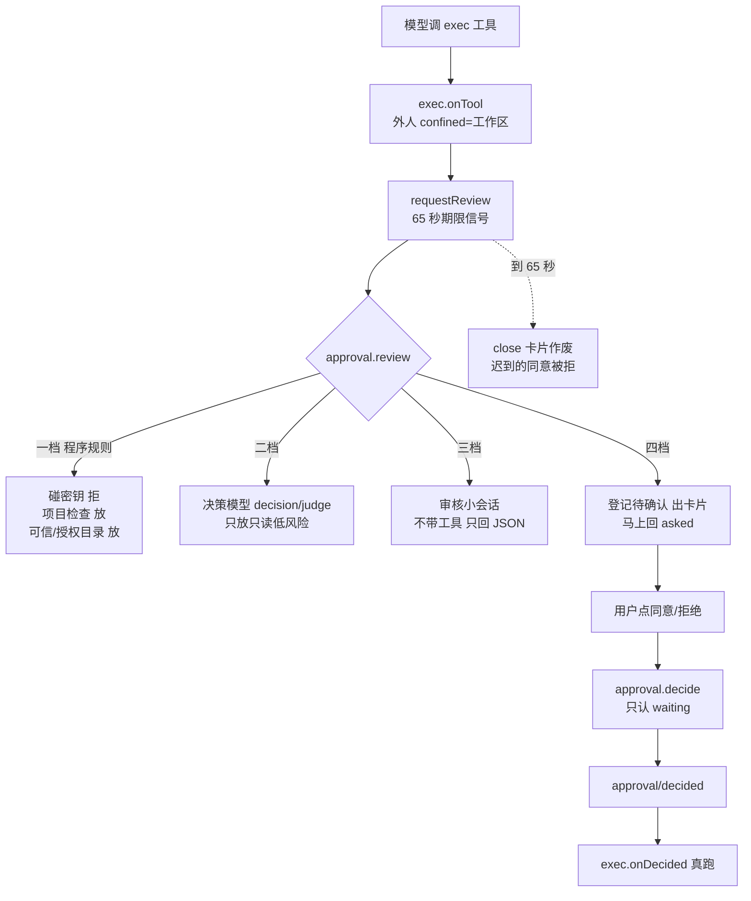
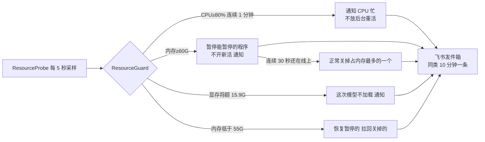

# 第十四块：安全审批与进程插件全链

读完这一块，你能说清楚：

1. 机器人想跑一条危险命令（比如删数据目录），从它开口到命令真跑起来，中间经过哪几道门、谁有权放行；
2. `trusted_dirs`（可信目录）、单轮临时授权、存表的目录授权三者有什么区别，为什么授权给一个目录就连子目录一起放开；
3. 审核为什么最多等 65 秒，到点后卡片怎么作废、迟到的“同意”为什么不再生效；
4. 外部程序（外置微信这类收费插件）的资源守卫：CPU 80%、内存 60G、显存 15.9G 三条线各自怎么判、怎么发通知、怎么降载；
5. 主程序和外部程序互相怎么认人（每次启动换一把新密钥），为什么外部程序只发二进制。

第五块讲过关口、`deny`/`stop` 和四档审批的大轮廓，第七块讲过 programs 怎么拉起、认人、看住外部程序。这一块把它们串成一条完整的链，再往深处挖：目录授权、超时作废、资源守卫的数字和动作。行号对的是 0.7.82 的源码。

**整块的类比**：jmbots 是一家医院。

- approval 是**医院安保科**：谁要进手术室、谁要动药房，先过安保；
- exec 是**手术室**：真正动刀（跑命令）的地方，但它自己不判断能不能动，一律先问安保；
- file-tools 是**病历室**：只能在本科室（工作区）和授权过的柜子里翻病历、写病历；
- programs 是**外包科室管理处**：外包科室（外部程序）在院外独立运营，管理处负责给它通电、发门禁卡、看它有没有把医院的电闸拉爆。

## 一图看懂





## 第一部分：一条高危命令怎么被拦、怎么放行

### 概念一：手术室不自己判断——exec 一律先问安保，最多等 65 秒

**一句话**：exec 收到模型的命令，先看说话的人是不是本人；不是本人，就把它关在工作区里（`confined`）。然后发 `approval/request` 请安保审，自己开一个 65 秒的倒计时。

外人怎么被关进工作区：

```ts
// src7/plugins/exec/index.ts
272	    //M 外人（builder、按授权升成 builder 的人）让跑的才限在工作目录里（审核照目录约束、只认授权目录、审不过直接拒）；
273	    //M   本人不限：后台在别的工作区、授权目录里干活，照本人的规则审，要问就出卡片（用户 #301）。
274	    let confined: string | undefined;
275	    if (!protocol.isOwnerTurn(session.row.channel, session.row.address)) {
276	      confined = cwd;
277	    }
```

倒计时和等待都在 `requestReview` 里：

```ts
// src7/plugins/exec/Runs.ts
84	export async function requestReview(ctx: cordis.Context, input: ReviewInput): Promise<ReviewVerdict> {
85	  //M 审核小会话（调模型）自己不限时：exec 给审批方一个期限信号，到期那一刻审批方停下、这边也结束等待。
86	  const review = new AbortController();
87	  const timeout = new DOMException(REVIEW_TIMEOUT_MESSAGE, 'TimeoutError');
88	  const timer = setTimeout(() => {
89	    review.abort(timeout);
90	  }, REVIEW_WAIT_MS);
91	  timer.unref?.();
92	
93	  //M 提问的会话喊停或到期，任一个都让审批方停下、这次等待结束。
94	  let signal = review.signal;
95	  if (input.signal !== undefined) {
96	    const signals = [input.signal, review.signal];
97	    signal = AbortSignal.any(signals);
98	  }
99	  const request = { action: 'review', input: { ...input, signal } } as const;
100	  const options = { prefix: 'apr', signal };
101	
102	  //M 发 approval/request 等审核结论。
103	  const asked = await requestEventModule.requestEvent(ctx, 'approval/request', 'approval/result', request, options);
104	  clearTimeout(timer);
105	
106	  //G 没拿到结论（到期、没挂 approval、会话喊停、出错）：让审批方停下，迟到的结果不再登记待确认；一律拒绝。
107	  if (asked.why !== undefined) {
108	    const timedOut = review.signal.reason === timeout;
109	    review.abort();
110	    if (timedOut) return { result: 'reject', by: 'rule', reason: REVIEW_TIMEOUT_MESSAGE };
```

要点：

- 65 秒（`src7/plugins/exec/Runs.ts:66` 的常量）不是“等用户 65 秒”，而是**等安保给出结论 65 秒**。安保走到第四档出了卡片，会马上回“已经去问了”（`asked`），exec 不再干等，告诉模型“别重复调，等通知”；
- 倒计时是一个信号（`signal`），同时交给安保。到点那一刻，安保里正在跑的决策模型、审核小会话一起停；
- 没挂 approval、超时、会话喊停、安保出错，一律当拒绝。**没有安保就不动刀**。

**类比**：护士推病人进手术室前，必须拿到安保科的放行条。安保科 65 秒内没给答复，这台手术就取消；安保说“要请院长签字”，手术室先去忙别的，院长签了再叫它。

### 概念二：安保四档——前一档能定的，后面的不用问

第五块讲过四档的轮廓，这里看第一档的细节，它决定了大部分命令根本不用问模型。

```ts
// src7/plugins/approval/index.ts
592	    //M 第一档：程序规则。碰了密钥文件直接拒绝；项目自己的检查直接放行。
593	    const secret = rules.touchesSecret(command);
594	    if (secret !== undefined) {
595	      const reason = `不准执行：命令碰了密钥文件 ${secret}。先用现有工具；缺能力时可用 agent_task 的 list 找执行端，再用 send（reply: false）留言`;
596	      return this.traced(input, { result: 'reject', by: 'rule', reason });
597	    }
598	    //G builder 的目录里 package.json 是他自己写的，“项目自己的检查”可能是任意命令，不直接放行。
599	    const runtimeRoot = this.ctx.resources.root;
600	    if (input.confined === undefined && rules.isProjectCheck(command, cwd, runtimeRoot)) {
601	      return this.traced(input, { result: 'pass', by: 'rule', reason: '项目自己的检查，直接执行' });
602	    }
```

- **碰密钥直接拒**：`touchesSecret`（`src7/plugins/approval/Rules.ts:155`）在命令里找 `config.yaml`、`.env`、`credentials.json` 这类文件名，前后要是分隔符，所以 `config.example.yaml` 不会误伤；
- **项目自己的检查直接放**：`isProjectCheck`（`src7/plugins/approval/Rules.ts:171`）只认 `bun run typecheck:src7`、`bun test …`、`bun scripts/Build_Src7.ts --键 值` 这几种，整条对得上、没用 `&`、`|`、`;` 接别的命令才算。外人不享受这条：外人目录里的 `package.json` 是他自己写的，“检查”可能是任意命令。

接着是**必问的一小块**和**目录放行**：

```ts
// src7/plugins/approval/index.ts
613	    //M 可信目录（用户 11-18 #169）和授权目录（用户 #301）：执行目录和命令里写的路径都落在这些目录里，
614	    //M   程序规则直接放行，不再问模型、不弹卡片；不在的记下是哪个路径。哪些目录算数见 getReviewDirs：
615	    //M   本人是配置的 trusted_dirs 加这一轮的授权目录；外人（confined）只认这一轮的授权目录。
616	    if (danger === undefined) {
617	      const reviewDirs = this.getReviewDirs(input);
618	      const untrusted = rules.getUntrusted(command, cwd, reviewDirs);
619	      let passReason = '可信目录';
620	      if (input.confined !== undefined) {
621	        passReason = '授权目录';
622	      }
623	      if (untrusted === undefined) return this.traced(input, { result: 'pass', by: 'rule', reason: passReason });
624	
625	      //G 外人这一轮带着授权目录（reviewDirs 不空），命令出了目录：规则直接拒，不问模型、不出卡片（用户 #301：出了这个目录照旧不行）。
626	      if (input.confined !== undefined && reviewDirs.length > 0) {
627	        const reason = `没放行：${untrusted}。只能在这一轮的工作目录和授权目录里动，别的要用户本人来说。`;
628	        return this.traced(input, { result: 'reject', by: 'rule', reason });
629	      }
630	
631	      asks.push(untrusted);
632	    }
633	
```

`mustAsk`（`src7/plugins/approval/Rules.ts:398`）只管三样：删系统目录、删注册表或格式化、删数据目录里的东西（机器人工作区除外）。命中了，后面的可信目录、决策模型一律跳过，审核小会话照开（为了写卡片内容），但它说“安全”也不放行，必须用户点头。

没命中，就看命令动到的路径是不是都在“算数的目录”里（`getUntrusted`，`src7/plugins/approval/Rules.ts:365`）：执行目录、命令开头 `cd` 去的目录、命令里写的绝对路径、带 `..` 往上走的相对路径，每一个都要落在目录里。写了 `%TEMP%`、`$env:`、`~` 这种算不出落在哪的，一律不算可信。

**类比**：安保科门口有一张白名单：带着违禁品（密钥文件）的直接拦；医院自己的例行体检（项目检查）直接放；进的是你自己科室（可信目录）的直接放；要拆承重墙（删系统目录、删数据）的，不管谁说没问题，都得院长签字。

### 概念三：三种“放开的目录”——可信目录、单轮授权、存表授权

“算数的目录”由 `getReviewDirs` 决定，它分人：

```ts
// src7/plugins/approval/index.ts
1103	    //M 外人让跑的（confined，exec 给 builder 和升成 builder 的人）：这一轮没授权目录，交回空的，照旧交给后面的模型审。
1104	    //M   外人地址里的 grants 只会是 Grants.applyMessage 按库查出来写的（原有的它先删掉）。
1105	    if (input.confined !== undefined && grantKeys.length === 0) return grantKeys;
1106	
1107	    //M 有授权目录的外人：他这一轮的执行目录（builder 自己的目录）加授权目录都算，出了这些 review 规则直接拒。
1108	    if (input.confined !== undefined) return [workspaceModule.getPathKey(input.confined), ...grantKeys];
1109	
1110	    //G 地址不是本人的：外人那一轮不给授权目录，只有配置的可信目录。
1111	    if (!isMarkedOwner(meta?.address)) return this.config.trustedDirs;
1112	
1113	    return [...this.config.trustedDirs, ...grantKeys];
1114	  }
```

| 名字 | 从哪来 | 给谁 | 管多久 |
|---|---|---|---|
| 可信目录 `trusted_dirs` | `config.yaml` 里 approval 的配置 | 只给本人 | 一直有效 |
| 单轮授权 | 本人说“这件事我授权了”，模型调 `dir_grant` 带 `once: true` | 本人这一轮 | 只这一轮，不存表 |
| 存表授权 | 本人说“把这个群绑到某目录”，`dir_grant` 存进表 `approval_grants` | 指定的人或群 | 撤掉之前一直有效 |

**只有本人能设授权**。工具里第一件事就是核身份：

```ts
// src7/plugins/approval/Grants.ts
355	    //G 只有本人那一轮能设：外人不能给自己放权限。
356	    const row = session.row;
357	    if (!protocol.isOwnerTurn(row.channel, row.address)) {
358	      throw new Error('只有用户本人那一轮能设目录授权');
359	    }
```

**外人自带的授权一律不认**。渠道进来的每一条话，先过 `Grants.applyMessage`，外人地址里原有的 `grants` 先删掉，再按人、按群去库里查：

```ts
// src7/plugins/approval/Grants.ts
111	    //G 外人地址里原有的 grants 一律不认：只有本人的网页消息能带（web-api 入口 checkGrants）。
112	    //G   先删、不碰库：后面查库出错时也不会把外人自己带的授权留下。
113	    if (!owner) {
114	      delete address['grants'];
115	    }
```

查到了，外人这一轮就升成 builder（能用写文件、跑命令的工具），工作区换到授权目录：

```ts
// src7/plugins/approval/Grants.ts
144	    //==========================================================
145	    const dirs = [...groupDirs, ...personDirs];
146	    if (dirs.length === 0) return;
147	
148	    //M 记下原来是不是 builder（登记了自己目录的人）：builder 没有群绑的目录时留在他自己的目录里。
149	    const wasBuilder = protocol.getSpeakerRole(address) === 'builder';
150	    setGrantDirs(address, dirs);
151	    address['role'] = 'builder';
152	    address['owner'] = false;
153	    message.role = 'builder';
```

外人有了授权目录后，命令出了这些目录，规则直接拒，不问模型、不出卡片（`src7/plugins/approval/index.ts:625–629`）。外人审不过也不出卡片，因为卡片登记了以后发起人自己说“同意 N”就等于自己批自己（`src7/plugins/approval/index.ts:693–696`）。

**为什么授权一个目录就连子目录一起放开**：判断“在不在目录里”用的是 `isPathInDirectories`，它看从目录走到目标要不要往上走：

```ts
// src7/utils/Workspace.ts
90	export function isPathInDirectories(dirs: string[], key: string): boolean {
91	  return dirs.some((dir) => {
92	    //G 换了盘符：path.relative 交回绝对路径，不在里面。
93	    const back = path.relative(dir, key);
94	    if (path.isAbsolute(back)) return false;
95	
96	    //M 要往上走（.. 开头）的在外面，别的都在里面。
97	    return back !== '..' && !back.startsWith(`..${path.sep}`);
98	  });
99	}
```

`path.relative` 从授权目录走到目标，只要不是 `..` 开头、也不是换了盘，就算在里面。所以授权 `D:\客户A` 以后，`D:\客户A\合同\2026` 自然在里面；`D:\客户A\..\客户B` 先被 `path.resolve` 解成 `D:\客户B`，走回去要 `..`，不算。

病历室（file-tools）读写文件用的是同一把尺子，还多一步：先把符号链接解开，防止有人在工作区里放一个指向外面的快捷方式：

```ts
// src7/utils/Workspace.ts
55	export function resolveWorkspacePath(workspace: string, relative: string, grantDirs: string[]): string {
56	  //M 目标路径照工作区解开，再解开符号链接，得到真正落在哪。
57	  const full = getReal(path.resolve(workspace, relative));
58	
59	  //M 工作区和授权目录也解开链接，目标落在其中一个里面（目录本身也算）就行。
60	  const roots = [workspace, ...grantDirs].map((dir) => getReal(dir));
61	  if (isPathInDirectories(roots, full)) return full;
62	
63	  //G 落到外面（../ 出去了、换了盘符、链接指出去）→ 不许。
64	  throw new Error(`路径出了工作区：${relative}（只能用工作区和授权目录里的路径）`);
65	}
```

**类比**：可信目录是院长自己的办公室钥匙；单轮授权是院长当场说“这一趟你跟我进去”；存表授权是给某个外包团队发的一张长期门禁卡，能开这一层所有房间，但开不了别的楼层。外人自己画的门禁卡，安保看都不看，直接收走。

### 概念四：超时作废和防重放——一张卡片只能定一次

两种情况会让一张卡片作废：

1. **登记卡片时已经过了 65 秒**：安保在第四档刚把卡片登记完，一看信号已经停了，当场作废，原因写“命令审核已超时”：

```ts
// src7/plugins/approval/index.ts
708	    //M 第四档：照审核模型写的内容拼一张卡片，登记待确认，问用户。不等用户：马上交回“已经去问了”，用户定了由 approval/decided 通知提的人。
709	    const card = reviewCardModule.reviewCard(input, script, answer, why, asks, decisionWhat);
710	    const detail = cardUtils.getCardText({ ...card, state: 'waiting' });
711	    const askInput = {
712	      kind: input.kind,
713	      title: card.title,
714	      detail,
715	      payload: input.payload,
716	      bot,
717	      session: input.session,
718	      card,
719	    };
720	    const pending = this.ask(askInput);
721	    //G 登记通知期间若已经截止，将这张卡片作废并保存明确原因。
722	    const afterAsk = getStoppedReview(input.signal);
723	    if (afterAsk !== undefined) {
724	      this.close(pending.id, afterAsk.reason);
725	      return this.traced(input, afterAsk);
726	    }
727
728	    return this.traced(input, { result: 'asked', id: pending.id, reason: `等用户决定（待确认 #${String(pending.id)}）` });
729	  }
```

2. **发命令的那边停下了**：命令窗口里那条被停掉，`Runs` 会发 `decide` 把它拒掉（`src7/plugins/exec/Runs.ts:236–240`）。

用户事后再点这张卡片，`decide` 会挡住：

```ts
// src7/plugins/approval/index.ts
908	  decide(id: number, approve: boolean, by: string, verified = true): Pending | string {
909	    //G 先按号找出这件待确认：找不到、已经定过的交回原因，不动表。
910	    const found = this.getRow(id);
911	    if (found === undefined) return `没有待确认 #${String(id)}`;
912
913	    //G 卡片作废后（审核超时、提的人不要了，都经 close）仍可能被点到：看卡片状态，交回作废时记下的原因，不比文字。
914	    if (found.card.state === 'ended') return `待确认 #${String(id)} ${found.by ?? '已作废'}`;
915
916	    if (!verified && found.kind === outboundModule.REMINDER_APPROVAL_KIND) return '定时提醒只接受本人确认';
917
918	    if (found.state !== 'waiting') return `待确认 #${String(id)} 已经定过了（${STATE_TEXT[found.state]}）`;
```

- 作废了的（卡片 `ended`，审核超时、提的人不要了都经 `close` 作废），回作废时记下的原因（比如“命令审核已超时”），不再比对文字；
- 已经定过的（不是 `waiting`），回“已经定过了”。飞书卡片点两次、网页和飞书各点一次，都只有第一次算数；
- exec 收到 `approval/decided` 时还会再看一眼：卡片是 `ended` 的直接不理（`src7/plugins/exec/index.ts:315–316`），不会在会话里冒出一句“用户同意了”。

**类比**：院长签字的单子只能用一次，签过的单子盖“已用”章；过了时效的单子盖“作废”章，谁拿着去手术室都不认。

## 第二部分：外包科室的资源守卫和门禁卡

### 概念五：三条线和恢复线——进线和出线分开，免得来回抖

数字都在 `Spec.ts` 的配置入口定，只解析一次：

```ts
// src7/plugins/programs/Spec.ts
371	  //M 统一在入口解析CPU进入线，内部不再读取原配置。
372	  const cpuPercent = getGuardNumber(raw, 'cpu_percent', 80, 1, 100);
373	  //M CPU恢复线与进入线分离，避免阈值附近反复抖动。
374	  const cpuResumePercent = getGuardNumber(raw, 'cpu_resume_percent', 70, 0, 100);
375	  //M 用户的G按GiB解释，容量只在本入口换算一次。
376	  const memoryGb = getGuardNumber(raw, 'memory_gb', 60, 0.001, 1_000_000);
377	  //M 读取用户已定的55GiB恢复线，而不是把60以下全部当恢复。
378	  const resumeGb = getGuardNumber(raw, 'resume_gb', 55, 0, 1_000_000);
379	  //M 逐卡显存硬线，不把多个卡容量合并。
380	  const vramGb = getGuardNumber(raw, 'vram_gb', 15.9, 0.001, 1_000_000);
381	  //M 显存退出线低于硬线，避免重复限流通知。
382	  const vramResumeGb = getGuardNumber(raw, 'vram_resume_gb', 15, 0, 1_000_000);
```

| 项 | 进线（默认） | 恢复线（默认） | 配置键 |
|---|---|---|---|
| CPU | 80% | 70% | `cpu_percent`、`cpu_resume_percent` |
| 内存 | 60 GiB | 55 GiB | `memory_gb`、`resume_gb` |
| 显存（每张卡） | 15.9 GiB | 15 GiB | `vram_gb`、`vram_resume_gb` |

恢复线必须低于进线，不然入口直接报错（`src7/plugins/programs/Spec.ts:383–391`）。采样默认每 5 秒一次（`interval_ms`，第 393 行）。

为什么要两条线：用的是“迟滞”。到进线才算忙，降到恢复线以下才算好，中间那一段保持原状：

```ts
// src7/plugins/programs/ResourceGuard.ts
337	    if (sample.cpu !== null) {
338	      if (sample.cpu >= this.settings.cpuPercent) {
339	        this.cpuBusy = true;
340	      }
341	      if (sample.cpu < this.settings.cpuResumePercent) {
342	        this.cpuBusy = false;
343	      }
344	    }
345	    //M 记下这一段CPU忙的起点，编译这类几十秒的高峰不够一分钟就不打扰用户。
346	    if (!this.cpuBusy) {
347	      this.cpuSince = undefined;
348	    }
349	    if (this.cpuBusy && this.cpuSince === undefined) {
350	      this.cpuSince = this.now();
351	    }
352	    const wasMemoryHigh = this.memoryHigh;
353	    if (sample.memory !== null) {
354	      if (sample.memory >= this.settings.memoryBytes) {
355	        this.memoryHigh = true;
356	      }
357	      if (sample.memory < this.settings.resumeBytes) {
358	        this.memoryHigh = false;
359	      }
360	    }
```

如果只有一条 80% 的线，CPU 在 79% 和 81% 之间来回跳，就会一会儿忙、一会儿闲，通知刷屏。读不到数（`null`）时也不改状态，**读不到不等于空闲**。

**类比**：病房空调设在 26 度开、24 度关，而不是 25 度一刀切，不然压缩机一分钟开关十次。

### 概念六：超线以后做什么——拒新活、暂停、最后才关一个

**新活先过准入**。外部程序启动前、要加载显卡模型前，都发 `programs/resource-request` 问守卫（Host 启动前问一次，`src7/plugins/programs/Host.ts:314`）：

```ts
// src7/plugins/programs/ResourceGuard.ts
219	    const now = this.now();
220	    const maxAge = Math.max(10_000, this.settings.intervalMs * 3);
221	    if (now - sample.at > maxAge || sample.at > now + 1000) return { ok: false, reason: '资源读数已过期，未放行' };
222	    if (sample.memory === null) return { ok: false, reason: '取不到内存读数，未放行新工作' };
223	    if (this.memoryHigh) return { ok: false, reason: '内存达到上限，低于恢复线后才开新工作' };
224	    if (request.heavy !== false && sample.cpu === null) return { ok: false, reason: 'CPU采样尚未就绪，未放行重活' };
225	    if (request.heavy !== false && this.cpuBusy) return { ok: false, reason: 'CPU忙碌，先不开后台重活' };
226	    if (request.vram_mb === undefined) return { ok: true, reason: 'CPU和内存允许开工' };
```

- 读数过期、读不到内存、内存在高位：一律不放；
- CPU 忙只挡“重活”（`heavy` 不是 `false` 的）；
- 显存按“已用 + 别人刚预留的 + 这次要的 + 512MiB 余量”算，超过 15.9G 和卡容量中较小的那个就不加载；放行的会预留 60 秒，防止两个请求同时看到同一份空闲显存（`src7/plugins/programs/ResourceGuard.ts:256–289`）。

**CPU 忙**：只通知、不关东西。连续忙满 1 分钟才发（编译这种几十秒的高峰不打扰用户），`src7/plugins/programs/ResourceGuard.ts:444–456`。

**内存超线**分两步：

1. 先让声明了能暂停的、jmbots 自己拉起的程序暂停后台（`pause`），等暂停请求都回来了再发通知，名单里只写确认暂停了的；
2. 连续 30 秒还在 60G 线上，才正常关掉一个：只在可关闭（`closable`）的程序里挑自报内存最多的那一个，而且关之前**重新采样一次**，不拿暂停前的旧读数当证据：

```ts
// src7/plugins/programs/ResourceGuard.ts
570	    if (this.shed || this.highSince === undefined) return;
571	    if (now - this.highSince < 30_000) return;
572	
573	    //G 暂停HTTP可能耗时，停进程前重新采样，不能拿暂停前的高读数当作“仍超限”。
574	    const latest = await this.refresh();
575	    if (this.control.signal.aborted) return;
576	    if (latest.memory === null || latest.memory < this.settings.memoryBytes) {
577	      this.highSince = undefined;
578	      return;
579	    }
```

一个高位周期最多关一个（`shed` 标记）。守卫不枚举系统进程、不按名字或任意 PID 杀东西，只动 programs 自己拉起的。通知里写清楚：“占内存的多半不是 jmbots 拉起的，jmbots 不会去关它们”，请用户自己去任务管理器看。

**恢复**：内存降到 55G 以下，只恢复守卫自己暂停过、而且“代次”没变的程序（用户中途手动重启过的不碰），被关掉的重新拉起（还要再过一次 CPU 准入），然后发一条“内存恢复”。

**通知怎么发**：都写进飞书发件箱 `integrations/feishu/outbox/`（`GuardNotices.ts` 先写 `.tmp` 再改名，`src7/plugins/programs/GuardNotices.ts:42–49`），由飞书插件稍后投递。同一类通知 10 分钟内只发一条：

```ts
// src7/plugins/programs/ResourceGuard.ts
684	  private notify(key: string, text: string): void {
685	    if (this.control.signal.aborted) return;
686	
687	    //M 准入、迟滞与通知使用同一可注入时钟，测试不用等待真实时间。
688	    const now = this.now();
689	    //M 先查本实例成功入队时刻，同类事件十分钟内不重复触发出口。
690	    const previous = this.notices.get(key);
691	    if (previous !== undefined && now - previous < 600_000) return;
692	
693	    try {
694	      //M 注入出口在测试只收集字符串；生产由既有飞书发件箱稍后投递。
695	      const queued = this.deliver(key, text, now);
696	      if (queued) {
697	        this.notices.set(key, now);
698	      }
```

正文四行固定：哪项超了、现在多少（线多少）、jmbots 做了什么、你可以做什么（`getNotice`，`src7/plugins/programs/ResourceGuard.ts:517`）。

**类比**：医院电闸快跳了，管理处先让外包科室的非急诊设备待机；30 秒还不行，才请用电最多的那个外包科室正常关门，并广播“电够了会请你们回来”。至于病人自己带来的电器，管理处只提醒，不去拔插头。

### 概念七：门禁卡——每次开门换一张，两个方向都要刷

**发卡**：每次拉起外部程序，Host 现场生成一把 32 字节随机密钥，只放进这个子进程的环境变量，不写日志、不进配置：

```ts
// src7/plugins/programs/Host.ts
382	      //M 每次拉起换一把新密钥，只放进这个子进程的环境变量，不写日志、不进配置。
383	      const key = crypto.randomBytes(32).toString('base64url');
384	      const env: Record<string, string | undefined> = { ...this.launch.env, [protocolModule.KEY_ENV]: key };
385	      delete env[protocolModule.CALLBACK_ENV];
386	
387	      //M 登记了渠道的程序还要知道往哪回调；主服务没开始监听前在这里等着，停止时随 signal 取消。
388	      const callback = await this.bridge?.getCallbackUrl(this.spec, signal);
389	      if (callback !== undefined) {
390	        env[protocolModule.CALLBACK_ENV] = callback;
391	      }
```

程序退出、重启，旧卡作废，新进程拿新卡。所以就算哪次密钥漏了，下次重启就没用了，这就是“轮换”。

**外部程序找主程序**（回调，比如外置微信收到一条消息要交给 jmbots）：请求头带 `x-jmbots-key`，主程序只信“这个程序此刻持有的那把”：

```ts
// src7/plugins/programs/ChannelBridge.ts
101	    const host = this.hosts.get(name);
102	    const given = request.headers[protocolModule.KEY_HEADER];
103	    const key = host?.getKey();
104	    //G 只信这个程序此刻启动持有的密钥。
105	    const allowed = protocolModule.isSameKey(key, given);
106	    if (!allowed) return reply.code(401).send({ error: '起草回调密钥不对' });
```

比对用的是固定时间比较，不会因为前几个字对上了就早退，防止有人一位一位地试：

```ts
// src7/plugins/programs/Protocol.ts
93	export function isSameKey(expected: string | undefined, given: unknown): boolean {
94	  if (expected === undefined || typeof given !== 'string') return false;
95	
96	  const left = Buffer.from(expected);
97	  const right = Buffer.from(given);
98	  if (left.length !== right.length) return false;
99	
100	  //M timingSafeEqual 要两边一样长，上面先比过长度。
101	  return crypto.timingSafeEqual(left, right);
102	}
```

**主程序找外部程序**（回发消息、打开它的网页界面）：主程序带上同一把钥匙，外部程序那边核对（外置微信在 `external/wechat/ChannelLink.ts:167–168` 核）。经主站转发打开外部程序的网页时，主站自己的令牌、Cookie 先剥掉，只换上这把启动密钥；外部程序回的内容里如果出现这把密钥，也会被换成星号再给浏览器（`redactProgramKey`，`src7/plugins/programs/index.ts:455`）：

```ts
// src7/plugins/programs/index.ts
384	  //M 地址里的 token 是主站令牌，转发前去掉，不交给外部程序。
385	  if (url.searchParams.has('token')) url.searchParams.delete('token');
386	
387	  const headers = new Headers();
388	  const connection = request.headers.connection ?? '';
389	  const linked = connection.toLowerCase().split(',').map((key) => key.trim());
390	
391	  //M 原始请求仍保留业务头，连接专用字段由客户端重新生成。
392	  utils.eachEntry(request.headers, (key, value) => {
393	    //G 鉴权由主 HTTP 服务处理，主站令牌、Cookie、Referer 不交给程序。
394	    if (HOP_HEADERS.has(key) || linked.includes(key) || PRIVATE_HEADERS.has(key)) return;
395	    if (typeof value === 'string') headers.set(key, value);
396	  });
397	  if (ui) {
398	    //G 客户端的同名头已丢弃，只用同一次读取就绪地址时取得的启动密钥。
399	    headers.set(protocolModule.KEY_HEADER, programKey);
400	  }
```

**为什么只发二进制**（第七块概念五讲过，这里补一句安全上的意义）：主程序不加载外部程序的代码，两边只靠“就绪行 + `/jmbots/v1/` 接口 + 门禁卡”说话。收费插件不暴露源码，授权它自己管；主程序这边也不用信任它的代码，它出了问题最多是自己起不来（10 分钟连崩 5 次就放弃自动重启，`src7/plugins/programs/Host.ts:342–346`），不会把主进程拖垮。

**类比**：外包科室每天早上到管理处领一张当天有效的门禁卡；它进医院要刷，医院派人进它的科室也要刷同一张。卡上的号码不会印在任何公告栏上，访客从医院大厅进外包科室时，医院自己的工牌先收走，只给他这张临时卡。

## 按这个顺序读

1. `src7/plugins/exec/index.ts` 第 266–305 行（`onTool` 从拿命令到交回结论）、第 312–340 行（`onDecided`）。
2. `src7/plugins/exec/Runs.ts` 第 60–120 行（65 秒和 `requestReview`）。
3. `src7/plugins/approval/index.ts` 第 583–710 行（`review` 四档全文）、第 855–895 行（`decide`、`close`）、第 1032–1057 行（`getReviewDirs`）。
4. `src7/plugins/approval/Rules.ts` 第 137–170 行、第 320–389 行（密钥、项目检查、可信目录、必问）。
5. `src7/plugins/approval/Grants.ts` 第 106–206 行（`applyMessage`、单轮授权）、第 347–392 行（`dir_grant`）。
6. `src7/utils/Workspace.ts` 第 55–99 行（路径落在哪、在不在目录里）。
7. `src7/plugins/programs/Spec.ts` 第 366–406 行（三条线的默认值）。
8. `src7/plugins/programs/ResourceGuard.ts` 第 207–290 行（准入）、第 336–409 行（迟滞）、第 412–620 行（每轮动作、降载）、第 684–700 行（通知去重）。
9. `src7/plugins/programs/Host.ts` 第 374–405 行（发密钥、拉起），`Protocol.ts` 第 1–15 行、第 85–102 行。

## 本块源码深度体检表

只列读源码时确认过的点，按要紧程度排。“改法”是建议，要不要改由中控定。

| # | 位置 | 问题 | 原因 | 建议改法 |
|---|---|---|---|---|
| 1 | `src7/plugins/approval/Rules.ts:373–377` | `mustAsk` 只看命令里的绝对路径，没写绝对路径就只看执行目录；`..` 往上走的相对路径不看 | 机器人在自己工作区里跑 `rd /s /q ..\..\..\memory`，删的是数据目录里的公共记忆，但执行目录在工作区里，不进“必问”。如果本人把数据目录配进了 `trusted_dirs`，`getUntrusted` 认为 `..` 解出来仍在可信目录里，第一档就直接放行了 | 照 `getUntrusted`（第 340–342 行）的做法，把带 `..` 或从盘根算的相对路径按 `cwd` 解开，一起放进 `targets` 再判 |
| 2 | `src7/plugins/programs/Protocol.ts:219–230`、第 297–308 行 | 主程序请外部程序退出（`requestExit`）、暂停和恢复（`requestPause`）时不带 `x-jmbots-key` | 外置微信把 `/jmbots/v1/exit` 列成不用验钥的公开路径（`external/wechat/License.ts:34`），本机任何进程都能让它退出；门禁卡只在渠道收发上刷，生命周期这条路没刷 | 两个请求都带上 `Host.getKey()`；外部程序那边退出、暂停、恢复接口改成验钥。注意 `requestExit` 在密钥作废前调用 |
| 3 | `src7/plugins/exec/index.ts:312–330` | exec 发起的待确认卡片没有有效期，用户隔几天点“同意”照样跑 | `decide` 只看是不是 `waiting`（`src7/plugins/approval/index.ts:869`），`onDecided` 收到就跑；那时工作区、会话早变了，命令可能已经不合时宜 | `onDecided` 里比一下 `pending.askedAt`，超过一个配置的时长（比如 24 小时）就按拒绝回会话；或在 approval 登记时带期限 |
| 4 | `src7/plugins/approval/index.ts:380`、`src7/plugins/exec/Runs.ts:67` | “命令审核已超时”这句话写了两份；`decide` 靠这个字符串相等判断卡片是不是超时作废的（`src7/plugins/approval/index.ts:864`） | 哪边改了措辞，另一边对不上，超时作废的卡片就会显示成“已经定过了（拒绝）”，原因不对 | 放进 `src7/utils/` 的一个共用常量，两边导入；或给卡片状态加一个明确的 `expired` 标记，不比文字 |
| 5 | `src7/plugins/programs/ResourceGuard.ts:247`、第 258 行 | 语音的 8GiB 显存预算按 `who === 'voice'` 写死；512MiB 安全余量也写死 | 违反“没有必要不许硬编码”：别的机器显卡大小不同，名字不叫 voice 的程序享受不到预算 | 进 `programs.guard` 配置（如 `budgets: { voice: 8 }`、`headroom_mb`），在 `Spec.ts` 入口解析一次 |
| 6 | `src7/plugins/programs/Spec.ts:314` | 外部程序继承主进程的全部环境变量（`{ ...process.env }`） | 主进程环境里如果有供应商密钥、代理账号，会原样交给收费二进制。门禁卡做得很细，环境变量却整份给了 | 只传系统必需的几项（`PATH`、`SystemRoot`、`TEMP` 这类）加 `spec.env`；真要继承全部就在配置里显式写 |

## 读完自测

1. 群里一位客户（不是本人）让机器人跑 `bun run test:src7`，第一档会直接放行吗？为什么？
2. 本人在飞书说“这件事我授权你动 `D:\合同`”，模型调了 `dir_grant` 带 `once: true`。下一轮本人再让它动 `D:\合同\2026`，还会弹卡片吗？
3. 安保走到第四档出卡片花了 70 秒，用户在 80 秒时点了“同意”，命令会跑吗？用户点两次会跑两次吗？
4. 机器内存 62G，持续了 20 秒又降到 58G，守卫会关程序吗？什么时候发“内存恢复”？

<details>
<summary>答案</summary>

1. 不会。exec 发现不是本人那一轮，把 `confined` 设成工作区；`review` 里“项目自己的检查”只在 `confined` 为空时才放行，因为客户目录里的 `package.json` 是他自己写的，`test` 可能是任意命令。接下来按授权目录和后面几档审，审不过直接拒，外人不出卡片。
2. 会。`once: true` 只把目录记进这一轮的当轮授权（`addTurn`），不存表；下一轮键变了，`getTurnDirs` 查不到。想长期放开，要让模型存表（不带 `once`）。在同一轮里，`D:\合同\2026` 在 `D:\合同` 里面，不弹卡片。
3. 都不会跑。65 秒时信号已经停了，卡片登记完 `afterAsk` 发现超时，当场 `close` 作废，exec 回模型“命令审核已超时”；80 秒的“同意”到 `decide` 被挡，回“已超时”。正常卡片点两次，第二次 `state` 已经不是 `waiting`，回“已经定过了”。
4. 不会关。62G 超过 60G，守卫先暂停能暂停的程序并通知；关程序要连续 30 秒在线上，20 秒就降了，`highSince` 清空。58G 还在 55G 恢复线上面，仍算高位，不发恢复；降到 55G 以下才恢复暂停的程序、发“内存恢复”。

</details>
