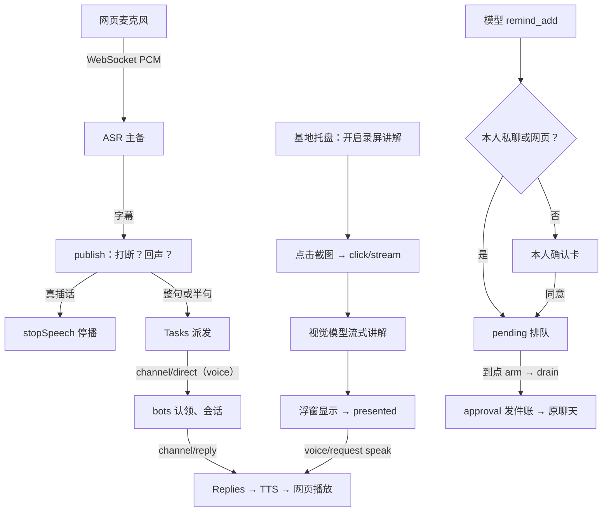

# 第十五块：语音 voice、录屏讲解 screen 与定时提醒

读完这一块，你能讲清楚 5 件事：

1. 对着网页说一句话，声音怎么变成文字、变成渠道消息、机器人的回话怎么念回来。
2. 机器人正在念，你一开口它就停：靠什么判断，回声怎么不被当成你说的话。
3. 录屏讲解是谁开的、截图从哪来、讲解怎么边出字边念。
4. 群里有人说“周六早上九点提醒大家开会”，提醒怎么存、谁要确认、到点怎么发、重启了会不会丢。
5. 这三块代码里有哪些隐患和可以瘦身的地方（文末体检表）。

要先读第二块（渠道消息 `channel/direct`、`channel/reply`）、第四块（一问一答 `requestEvent`）、第五块（审批卡）、第七块（基地和进程）。

> 类比：**voice 是门诊的电话分诊台**，你说话它一边记、一边听你说完没有，医生开口回答时你插嘴它马上闭嘴；**screen 是陪诊员**，你在屏幕上点哪儿，它看一眼就在旁边小声讲；**提醒是预约挂号单**，约好的时间到了自动打电话，群里的陌生人约的要主任先签字。

## 一图看懂

```
【语音】
网页麦克风 → WebSocket /api/voice/ws
  │ 16kHz PCM 二进制帧
  ▼
ASR 主备：本地 sherpa ⇄ 云端
  │ partial 字幕 / final 整句
  ├ 机器人在念 + 你说了≥3 个字
  │  且不像回声 → 停播
  ▼
Tasks：够了就开工（半句 partial）
  → channel/direct（渠道 voice）
  → bots 认领 → 会话
  → channel/reply → TTS → 网页播

【录屏】基地托盘“开启录屏讲解”
  → 本机截图 → POST /api/screen/click/stream
  → 视觉模型流式出字 → 浮窗显示
  → /presented → voice/request speak

【提醒】模型调 remind_add
  本人私聊/网页 → 直接排队
  群里或外人 → 本人确认卡
  到点 → approval 发件账 → 原聊天
```

## 一、语音：从麦克风到念回来

### 1.1 声音怎么进来

- 网页打开麦克风（回声消除、降噪、单声道），建一条 WebSocket 连到 `/api/voice/ws`：

```ts
// src7/plugins/voice/Config.ts
19	const DEFAULT_WS = '/api/voice/ws';
```

- 第一帧是文字 `{ type: 'start', bot, lang, device }`；之后是二进制帧：16kHz、16 位、单声道 PCM。服务端回 `ready`，告诉网页用的是哪条识别线路、打断开没开。
- 语音插件**默认关**（`voice.enabled` 不写是 false），要在配置里打开。

### 1.2 识别：本地和云端互为备份

- 主线路和备用线路必须**一个本地、一个云端**（本地 sherpa-onnx；云端百炼或小米）。
- 一条线路出错，`RoutedAsr` 关掉它、换下一条，并把还没被确认的那段 PCM **重放给新线路**，你说的话不丢；两条都坏了才报错关连接。
- 本地模型全用 CPU，加载前先过资源守卫（第七块的 programs）。

### 1.3 话说完没：不等你停 1.2 秒

- 普通做法：静音 1.2 秒算一句完。
- 提前断句（只有本地 sherpa 能做）：停顿够 300 毫秒、已经说了 6 个字以上，就问一个很小的内置模型“这句话像说完了吗”，说是就立刻切句。
- 半句提前开工：话还没说完，字数够了也可以先派给机器人开始想（消息带 `routing.partial`），整句来了再补上。

### 1.4 变成渠道消息

语音就是一个渠道，名字叫 `voice`。整句和半句都当私聊发 `channel/direct`：

```ts
// src7/plugins/voice/Tasks.ts
493	      //M 整句、半句都发 channel/direct（语音是私聊）；半句带 partial，VoiceReplies 登记等整句入档，记忆不记。
494	      await channel.emitInbound(this.ctx, message, true, control);
```

- 整句先发 `voice/record`，网页聊天记录里就有了这一条（web-api 听它写时间线）。
- 记忆、聊天归档、审批都**跳过半句**，等整句再记，不会记两遍。

### 1.5 回话念出来

- `Replies` 听 `channel/reply`，只接渠道是 `voice` 的；先给网页发一帧文字 `reply`，再交给 TTS。
- TTS 也是主备：默认小米云端，退回本地 MeloTTS。按顺序一段段合成，发 `audio-start` → PCM → `audio-end`。
- 网页播完回 `audio-played`，回执里带“念到哪了”。

> 类比：分诊台一边听电话一边记，听出你说完了就递给医生；医生的回答由广播员念出来，念完回一张“已广播”的条子。

## 二、打断：你一开口它就闭嘴

**默认开**，阈值都能配：

```ts
// src7/plugins/voice/Config.ts
143	  //M 默认双工：barge_in 不写就是开。
144	  const interrupt = checks.checkFlag(voice['barge_in'] ?? true, 'voice.barge_in');
145	  const minChars = count(voice['barge_in_min_chars'], 'barge_in_min_chars', 3);
146	  const echoWritten = voice['barge_in_echo_similarity'] ?? 0.75;
```

判断在 `publish`（每来一段字幕就过一遍）：

```ts
// src7/plugins/voice/index.ts
755	      if (!final && characters.length < bargeIn.minChars) return;
756
757	      const isEcho = characters.length === 0 || matchesPlayback(characters, echo.text, bargeIn.echoSimilarity);
758	      if (isEcho) {
759	        if (final && this.partial !== '') {
760	          //M 识别器把已显示的插话改判为回声时，清掉临时字幕并回收该句。
761	          const frame = { type: 'partial', seq: this.seq, text: '' };
762	          this.send(frame);
763	          this.partial = '';
764	          this.turn?.reset();
765	          this.seq += 1;
766	        }
767	        return;
768	      }
769
770	      if (!this.stopping && this.partial === '' && this.playing === echo.job) {
771	        //M 用已有的停播路径清掉当前及排队语音，同时继续转写这句插话。
772	        this.stopSpeech();
773	      }
```

一句话讲清楚：

1. **字数不够不算**：机器人在念的时候，你这段临时字幕不到 3 个有效字（去标点、统一大小写后），先不理。
2. **像回声不算**：麦克风可能把喇叭里的声音又收进来。拿你这段字和“正在念的那句”比，整段被包含、或者编辑距离算下来相似度 ≥ 0.75，就当是回声，丢掉；已经显示出来的临时字幕也撤回。
3. **真是你说的**：调 `stopSpeech`，清掉排队的语音、掐断正在合成的、通知网页停播。**同一条音频流继续识别**，你这句话照常往下走。

回声比对用 `matchesPlayback`（`voice/index.ts:170`）。播放窗口按已发出去的 PCM 时长算，再加 100 毫秒余量、150 毫秒尾巴。

注意：打断只停**声音**，不停机器人正在跑的会话。新的话如果在 30 秒合并窗口里，会作为“【补充】”并进上一场。

## 三、录屏讲解：点哪儿讲哪儿

### 3.1 谁开的

- **基地托盘菜单“开启录屏讲解”**，不是网页按钮，也不是模型工具（`local/src/window.rs`）。
- 基地先 `GET /api/screen/status` 看后端开没开，再 `POST /api/screen/state` 发 `user_start` 拿一个 10 秒的租约，之后发心跳续租。
- 后端、基地两边都**默认关**：配置顶层 `screen` 段写 `enabled: true`，plugins 里挂 `- name: screen`，再在托盘点一下才开始。

### 3.2 截图从哪来、去哪

- 基地用 Windows 采集，帧放在内存环形缓存里；你点一下，取点击前那一帧，过隐私检查（黑名单程序、密码框），裁成最多 256 KiB 的 JPEG。
- 只发给本机后端（基地只认回环地址），后端只交给配置的视觉模型（默认 `magpie/xiaomi/mimo-v2.6-flash`，思考关）。
- **不落盘**：一次讲解跑完，内存里的图和控件文字立即清空。

### 3.3 边出字边念

- 点击走 `POST /api/screen/click/stream`，回的是 NDJSON 流。
- 模型一边吐字，后端一边找第一个完整短句（5～160 字，到标点就切），先发 `partial` 给基地浮窗显示；整段出来后剩下的作为第 2 段。
- 基地每显示一段，就回 `POST /api/screen/presented`；后端这时才请 voice 念：

```ts
// src7/plugins/screen/Screen.ts
640	    //M 仅语音开启且有人监听时发讲解文本；语音失败不影响已显示结果。
641	    speech.presented = segment;
642	    const group = this.getVoiceGroup(state);
643	    const interrupt = segment === 1;
644	    const request = { action: 'speak', text, group, interrupt } as const;
645	    const options = { warnAfterMs: VOICE_WARN_MS };
646
647	    //M 同一片段只发一次，等待原语音回执。
648	    const answer = await requests.requestEvent(this.ctx, 'voice/request', 'voice/result', request, options);
```

- 第 1 段带 `interrupt: true`（打断上一次讲解的声音），每段只发一次；新的点击、取消、租约过期都会发 `stop` 停掉这一组声音。
- 语音没挂、`speak` 没开，只显示不念。

### 3.4 浮窗

- 基地的 Tauri 小窗：置顶、鼠标穿透、**把自己从截屏里排除**（不会讲解到自己）。
- 落在你点击的那块屏上、避开点击点；“固定副屏”只在本地演示时用。

> 类比：陪诊员只在你叫她（托盘）时上岗，每 10 秒你点个头她才继续；她看一眼你指的地方，先说一句短的，再补充，说完就忘，不留照片。

## 四、定时提醒：预约单、主任签字、到点打电话

### 4.1 谁能建、建在哪

提醒在 **assist** 插件（`assist/Reminders.ts`），给模型三个工具：`remind_add`、`remind_list`、`remind_cancel`。

- 只认两种可信来源：**飞书群或飞书私聊**、**已核验的本人网页**。别的来源（比如没核验的网页）建不了。
- 目标只能是“本轮这个聊天”，模型不能随便指定发到哪。
- 模型每轮会收到一句提示：现在是配置时区的几点、星期几，“周六早上”要换算成具体日期。

### 4.2 本人直通，群里和外人要确认

```ts
// src7/plugins/assist/Reminders.ts
483	      const ownPrivate = source.role === 'owner' && source.chatType === 'p2p';
484	      const ownerConfirmed = Number(ownPrivate || source.channel === 'http');
485	      let state = 'awaiting';
486	      if (ownerConfirmed === 1) {
487	        state = 'pending';
```

- **本人私聊、本人网页**：直接 `pending`（排队等到点）。
- **群里（哪怕是本人在群里说的）或外人私聊**：先 `awaiting`，给本人发一张确认卡（第五块的审批卡）。本人点同意变 `pending`，点拒绝变 `rejected`。
- 外人只能看、只能取消自己建的提醒；本人能管整个聊天的。

### 4.3 到点怎么发

- **只给最早的一条上闹钟**（`arm`）：到点醒来再从库里读最新状态，不会给一百条提醒开一百个定时器。超过 24.8 天的，先睡到上限再算。
- 到点时用一句 SQL **原子占位**：把最早到期的一条改成 `sending`、同时冻结要发的正文，取消和发送不会撞车：

```ts
// src7/plugins/assist/Reminders.ts
554	        const sql = "UPDATE assist_reminders SET state = 'sending', send_text = CASE WHEN due_at < ? OR late = 1"
555	          + " THEN '补发提醒（原定 ' || local_at || ' ' || time_zone || '）：' || text ELSE '提醒：' || text END"
556	          + " WHERE id = (SELECT id FROM assist_reminders WHERE state = 'pending' AND due_at <= ?"
557	          + ' ORDER BY due_at, id LIMIT 1) RETURNING *';
```

- 发送不是 assist 自己发，而是经一问一答交给 **approval 的发件账**（`approval/reminder-send`）。approval 再回头读那一行冻结的记录，**确认过才发**：

```ts
// src7/plugins/approval/Outbound.ts
225	    const row = lookup.reply?.row;
226	    if (row?.confirmed !== true) return { status: 'failed', reason: '提醒未到期、未获批准或已经处理' };
```

- 发件账按 `assist-reminder:<编号>` 去重，同一条提醒重复交接也只发一次。

### 4.4 重启不丢、错过补发

- 提醒存在 `assist_reminders` 表（`data/jmbots7.db`），重启从库里接着排。
- 重启时卡在 `sending` 的，按原编号、原正文再交给发件账，由发件账判断是不是已经发过。
- 停机期间错过的，发的时候前面加“补发提醒（原定 某时 某时区）：”。
- 结果拿不准的（网络断在半路），记成“待核对”，**不自动重发**，免得群里收到两遍。
- 要等 approval 就绪才开始排（`assist/index.ts:330`）；approval 卸了就暂停。

> 类比：预约单写好存档；主任签了字才排进日程；到点护士只拿最上面一张去打电话，打之前在单子上盖“正在打”；电话没确认打通的，标“待核对”，不会再打一遍。

## 流程图



## 按这个顺序读源码

1. `web/src/Chat/VoiceCapture.ts:230`：网页建语音连接。
2. `src7/plugins/voice/index.ts:729`：`publish`，字幕、打断、回声。
3. `src7/plugins/voice/RoutedAsr.ts:206`：`fail`，识别线路主备切换。
4. `src7/plugins/voice/Turn.ts:53`：`accept`，提前断句。
5. `src7/plugins/voice/Tasks.ts:494`：`emitInbound`，变成渠道消息。
6. `src7/plugins/voice/Replies.ts:164`：`deliver`，回话交给 TTS。
7. `src7/plugins/screen/index.ts:131`：流式讲解接口。
8. `src7/plugins/screen/Screen.ts:363`：`explain`，调视觉模型、切句。
9. `src7/plugins/assist/Reminders.ts:457`：`add`，建提醒。
10. `src7/plugins/assist/Reminders.ts:543`：`drain`，到点占位发送。
11. `src7/plugins/approval/Outbound.ts:220`：`sendReminder`，发件前核对。

## 自测

1. 机器人正在念“好的，我来查一下”，你说了一个“嗯”，会停吗？

<details><summary>参考答案</summary>

不会。临时字幕不到 3 个有效字（`barge_in_min_chars`），直接不理。说够 3 个字、而且和正在念的那句不像（相似度低于 0.75），才调 `stopSpeech` 停播。

</details>

2. 本地识别模型突然崩了，你说到一半的话会丢吗？

<details><summary>参考答案</summary>

不会。`RoutedAsr` 关掉坏线路、换到云端备用线路，并把还没被确认的那段 PCM 重放给新线路。两条都坏了才报错关连接。

</details>

3. 录屏讲解的截图会存到硬盘上、或者发给群里的人吗？

<details><summary>参考答案</summary>

不会。截图只在基地内存的环形缓存里，点击后只发给本机后端（基地只认回环地址），后端只交给配置的视觉模型；一次讲解跑完就把图和控件文字清空，不落盘、不进会话记录。

</details>

4. 群里一个外人让机器人“明早 9 点提醒大家交报告”，然后服务在 8:30 到 9:30 之间重启了，会怎样？

<details><summary>参考答案</summary>

外人在群里建的提醒先是 `awaiting`，要本人点确认卡同意才排队。同意之后到点前重启没关系：提醒在库里，重启后接着排；如果重启时已经过了 9 点，发出去时前面加“补发提醒（原定 …）”。要是重启那一刻正在发、结果拿不准，标“待核对”，不自动再发。

</details>

## 本块源码深度体检

每条都对过源码；“待核”是没把握是不是有意这么写，要实测或问作者。

| # | 位置 | 问题 | 改法 |
|---|---|---|---|
| 1 | `voice/Replies.ts:159` | 回话回执的 Map 只往里加、从不删，长期开着语音内存会一直涨 | 加上限或过期时间（比如只留最近 200 条） |
| 2 | `voice/CloudAsr.ts:86` | 能量过阈值就起 8 秒“等字幕”计时，持续背景噪声或回声可能被当成识别超时、白白切线路（待核，要实测） | 收到第一段临时字幕后再计时，或按连续有声时长算 |
| 3 | `voice/Asr.ts:19` | `onSpeechStart` 本地、云端、主备三层都实现了，但网页连接从没接上它，是死路径；打断现在靠文字判断 | 删掉，或接给打断做“一出声就预停” |
| 4 | `voice/Turn.ts:66` | 写死 6 个字，而且按 UTF-16 长度数；`Tasks.ts` 用配置的 `min_chars` 按字数数，两个口径；两处还各写了一套“每分钟最多几次” | 字数从配置传入、统一按字数数；限速抽成一个小类共用 |
| 5 | `voice/index.ts:729` | `publish` 约 70 行混了回声、停播、派发；`apply` 约 200 行 | `publish` 拆出 `checkEcho`；`apply` 拆出事件登记 |
| 6 | `voice/Tasks.ts:10` | 渠道名 `'voice'`、客户号 `'voice:本机'`、`'local'` 在 `Tasks.ts`、`Replies.ts`、`index.ts` 各写一份；超时常量（8000、5000、20000、22000）散在各文件 | 集中到一个文件导出 |
| 7 | `screen/Screen.ts:744` | 读 Cordis 的私有字段 `_hooks` 判断有没有人听 voice，升级 Cordis 容易坏 | 改问 voice 一个 `status`，或直接发请求、按 `unhandled` 判断 |
| 8 | `screen/index.ts:126` | 后台“两层分析”的 `/observe` 接口，基地侧没有任何调用方（`transport.rs` 的路由里没有它），连同 `Analysis.ts` 可能是死代码（待核） | 确认没人调就删掉，或在说明里写明“预留” |
| 9 | `screen/Screen.ts:226` | `enabled: false` 时也每 250 毫秒跑一次清理定时器（有 `unref`、卸载会清，不算泄漏） | 没开就不建定时器，或第一次有会话时再建 |
| 10 | `screen/Screen.ts:363` | `explain` 约 120 行、`getModelAnswer` 约 107 行、`setState` 约 93 行 | `explain` 拆出“回执入缓存、切第 2 段”；`getModelAnswer` 拆出拼参数 |
| 11 | `assist/Reminders.ts:135` | 提醒表自己 `CREATE TABLE`，没走 db 迁移账本，以后加列只能在插件里自己 `ALTER` | 改成 db 账本迁移 v1（`adoptColumn` 接管已有表） |
| 12 | `assist/Reminders.ts:89` | 可信来源只认飞书和本人网页，写死了渠道名；微信等渠道接进来要改这里 | 改问 channels 的 `isOwnerTurn` 和一个“渠道是否支持主动发件”的标记，不写死渠道名 |

下一块：待定（中控登记总览时填）。
