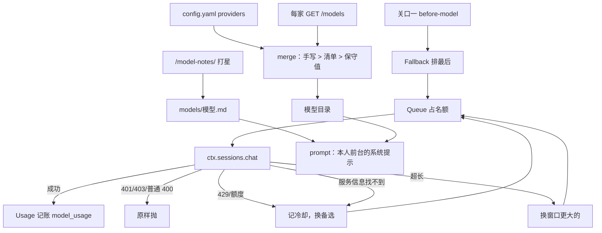

# 第十六块：模型调度 model-catalog、限流熔断、用量计费与打分

读完这一块，你能讲清楚 5 件事：

1. 有哪些模型能用、每个模型的窗口和价格从哪来；思考档 `off`～`max` 怎么变成真正发给供应商的参数。
2. 改了 `config.yaml` 里的密钥为什么不用重启，什么改动又必须重启。
3. 关口一最后那位“转诊专员”`Fallback.ts`：被限流、上下文超长、上游找不到服务时怎么换模型；哪些错不换。
4. 每调一次模型花了多少钱，记在哪、在哪看。
5. `/model-notes/` 给模型打的星，怎么写进 Markdown、又怎么回到本人前台的提示词里。

要先读第一块（四个关口）、第四块（一问一答）。第十一块讲过“模型其实是 model-catalog 在关口一里代调的”，这一块把它拆开讲。

> 类比：**model-catalog 是医院的医生排班表加财务科**。排班表写着每位医生（模型）擅长什么、一次能看多少病历（窗口）、挂号费多少（单价）；**转诊专员**（Fallback）负责把病人送到医生那儿，医生满了就排队，医生停诊（限流）就转给同科的别的医生；**财务科**（Usage）每看一次记一笔账；**病人评价簿**（Notes）记着大家给每位医生打的星，主任派活时会翻一翻。

## 一图看懂

```
config.yaml providers（手写）
   + 每家 GET /models（远端清单）
   │ merge：手写 > 清单 > 保守值
   ▼
模型目录（内存表，60 秒重试没拉到的）
   │ 答 model-catalog/request
   │   find：窗口、价格、思考档
   │   prompt：模型介绍+评价（给本人）
   ▼
关口一 session/before-model（排最后）
 Fallback：
   原模型不在冷却 → Queue 占名额 → chat()
   出错？
    ├ 401/403、普通 400 → 原样抛
    ├ 429/额度 → 记冷却，换备选
    ├ 上下文超长 → 只换窗口更大的
    └ 400 服务信息找不到 → 换备选
   ▼
session/new-message（assistant）
   → Usage 按单价记账 model_usage
/model-notes/ 打星 → models/<模型>.md
   → 本人前台的系统提示词
```

## 一、模型目录：排班表怎么来

### 1.1 两个来源，一张表

- **手写**：`config.yaml` 的 `providers.<家>.models` 写的模型、价格、窗口、思考档。
- **远端清单**：每家 `GET <地址>/models` 拉一次（`Pull.ts` 的 `fetchList`）。一家拉不到不挡别家，没拉到的每 60 秒再试：

```ts
// src7/plugins/model-catalog/index.ts
152	const RETRY_MS = 60_000;
```

- 合并规则就一句话：**手写的优先，清单的其次，都没有用保守值**：

```ts
// src7/plugins/model-catalog/Pull.ts
115	export function merge(
116	  provider: string,
117	  entries: ListEntry[],
118	  written: Record<string, WrittenModel>,
119	): { models: ModelInfo[]; guessed: number } {
```

- 保守值：窗口 128000、最大输出 8192，并标上“窗口是估的”（context-fit 看到估的就不压缩，见第十三块）。
- 没标价的记 0，**不等于免费**。
- 带参数的清单（magpie、OpenRouter）缺窗口的就当不是对话模型；只给 ID 的清单按名字筛掉嵌入、语音这类。

### 1.2 别的插件怎么问

一问一答 `model-catalog/request` → `model-catalog/result`，只有两种：

| action | 谁问 | 回什么 |
|---|---|---|
| `find` | context-fit（窗口）、Usage（单价） | 一个模型的窗口、价格、思考档、是不是看图 |
| `prompt` | bots 的 `DispatchTools`（本人前台） | 所有模型的介绍、平均星级、能用的思考档 |

要整张列表就走 HTTP `GET /api/models`。

### 1.3 思考档：七档，交给 pi 去翻译

- 七档：`off`、`minimal`、`low`、`medium`、`high`、`xhigh`、`max`；配置里不写默认 `low`。
- 骨架发请求时只做一件事：不是 `off` 就把档名原样交给 pi：

```ts
// src7/Sessions.ts
554	    //M 思考档不是 off 才传 reasoning；off 就不传，模型不思考。
555	    if (request.thinking !== 'off') {
556	      options.reasoning = request.thinking;
557	    }
```

- 真正发什么参数（`reasoning_effort`、`enable_thinking`、思考预算……）由 pi 的适配器按模型的 `thinkingFormat` 翻译。jmbots 代码里**没有任何千问特判**。
- 某个模型不支持你要的档，pi 先往深、再往浅找最近的一档（比如千问内置只有 low/medium/xhigh，要 high 就给 xhigh）。
- 自家模型想用千问的格式，在 `config.yaml` 的 `model_compat` 里写 `thinkingFormat`。

### 1.4 改密钥为什么不用重启

- 骨架 `Resources` 用 `fs.watch` 盯着 `config.yaml`，改了就重新校验一遍；校验不过保留旧配置。
- 关键在这里：**每次发请求时才去取密钥**，取的是当前那份配置：

```ts
// src7/Resources.ts
324	        resolve: async () => {
325	          const providers = this.config.providers;
326	          //G 删除供应商后，旧的鉴权回调不再交回密钥。
327	          if (!Object.hasOwn(providers, providerName)) return undefined;
328
329	          //M 在同一快照取地址和密钥，缓存过模型的调用方也会向当前地址请求。
330	          const current = providers[providerName]!;
```

- 所以改密钥、改地址，下一次请求就生效；还没拉到清单的家，60 秒内会用新密钥自动重试。
- **要重启的**：新增或删掉一家供应商、改手写模型的名字或价格——目录在插件挂上时就建好了，不跟着配置变。这时目录显示的和实际发请求用的可能对不上（发请求的窗口、思考映射是现读配置的）。

## 二、转诊专员：Fallback 怎么换模型

第十一块说过：`Fallback.ts` 挂在关口一 `session/before-model` 的**最后**，自己调骨架的 `ctx.sessions.chat`，把回答填进 `request.answer`，骨架看到有回答就不再调。为什么要自己调？因为只有它知道“这个错要不要换人”。

### 2.1 先看错是哪一类

```ts
// src7/plugins/model-catalog/Fallback.ts
117	function getFallbackReason(error: string): RetryableReason | undefined {
118	  const status = getClientErrorStatus(error);
119
120	  //G 鉴权响应即使带额度或服务名，也按原错返回。
121	  if (status === '401' || status === '403') return undefined;
122
123	  const serviceMissing = /服务信息找不到|\bservice info(?:rmation)? (?:was )?not found\b/iu.test(error);
124	  if (status === '400' && serviceMissing) return 'upstream-unavailable';
125
126	  if (isOverflow(error)) return 'context-overflow';
127	  if (isRateLimited(error)) return 'rate-limit';
128
129	  return undefined;
130	}
```

| 错 | 怎么办 | 为什么 |
|---|---|---|
| 401、403（鉴权） | **原样抛，不换** | 密钥错了，换别的模型也是瞎试，还会把对话发给更多家 |
| 普通 400（参数错） | **原样抛，不换** | 请求本身有问题，换谁都一样 |
| 400 且是“服务信息找不到” | 换备选链 | 网关那头这个模型下线了 |
| 上下文超长 | **只换窗口更大的**，大的排前 | 换个一样小的没用 |
| 429、额度用完 | 记冷却，换备选 | 这位医生停诊了 |

### 2.2 限流：只再试 1 次，然后冷却

- pi 自己会对同一个模型重试几次。但被限流时多试没用，所以 Fallback 一边调、一边听 `session/model-failed`，数到第 2 次限流就自己掐断，按限流往外抛：

```ts
// src7/plugins/model-catalog/Fallback.ts
307	    const stopListening = this.ctx.on('session/model-failed', (info) => {
308	      if (info.session !== request.session || info.model !== model) return;
309
310	      const failure = getFallbackReason(info.error);
311	      if (failure !== 'rate-limit') return;
312
313	      limited += 1;
314	      limitError = info.error;
315	      if (limited > RATE_LIMIT_RETRIES) {
316	        controller.abort();
317	      }
318	    });
```

- 记冷却：从报错里读“几点恢复”（带时区的时间，或 `retry after N 秒`），读不出就按配置的分钟数（默认 5），最长一天。冷却表只在内存，重启就清。
- 冷却中的模型：下一步直接跳过，用备选；冷却过了自动回到原模型。会话记录里的模型故意不改，就是为了能用回来。

### 2.3 备选从哪来

- `fallback.chain` 写的备选链，加上**同一家里标价为 0 的对话模型**（`include_siblings`，默认开），去重、去掉原模型，最多试 5 个：

```ts
// src7/plugins/model-catalog/Fallback.ts
401	    let free: string[] = [];
402	    if (siblings) {
403	      free = models
404	        .filter((item) => item.kind === 'chat' && item.id.split('/')[0] === provider)
405	        .filter((item) => item.price.input === 0 && item.price.output === 0)
406	        .map((item) => item.id);
407	    }
```

- 都失败了，把每个试过的模型和原因拼成一句人话往外抛：全是超长就说“这个会话聊得太久了，开个新会话”，全是限流就说“额度不够，去 `fallback.chain` 加能用的”。
- 原模型在冷却、又一个备选都没有：还是硬着头皮调原模型（冷却记错了也不至于一个都不用）。

### 2.4 排队：每个模型、每家供应商同时几个

`Queue.ts`：先占模型的名额，再占供应商的名额（写了上限才占），做完反着还，成败都还。排队时会话被喊停就不等了。**没有排队超时**。

```ts
// src7/plugins/model-catalog/Queue.ts
42	    //M 先抢占该模型的并发名额，防止单个模型并发过高触发限流。
43	    await this.acquire(`模型:${model}`, this.limits.models[model] ?? this.limits.perModel, signal);
```

> 类比：转诊专员先看病人的问题——医保卡刷不过（401）就不转了，转谁都刷不过；医生停诊（429）就记一笔“几点复诊”，转给同科室的；病历太厚这位看不完（超长），只转给能看更厚病历的；每位医生门口一次只能排几个人。

## 三、用量计费：财务科记账

- 听两件事：模型回答成功（`session/new-message`，只看 `assistant`），失败（`session/model-failed`，token 记 0、错误留 300 字）。失败重试也每次记。
- 单价从目录里 `find` 出来，按**每百万 token** 算，四项分开：

```ts
// src7/plugins/model-catalog/Usage.ts
255	    if (price !== undefined) {
256	      cost = ((usage.input * price.input) + (usage.output * price.output)
257	        + (usage.cacheRead * (price.cacheRead ?? 0)) + (usage.cacheWrite * (price.cacheWrite ?? 0))) / 1e6;
258	    }
```

- 存在 `data/jmbots7.db` 的 `model_usage` 表：时刻、供应商、模型、用途（前台、后台、压缩……）、机器人、会话、四种 token、花费、耗时、成功与否、错误。
- 看账：`GET /api/usage?by=hour|day|week|month&group=provider|model|purpose|bot&from=&to=`，默认最近 7 天，带缓存命中率。网页的用量页就读它。

## 四、打分：评价簿怎么回到派活提示

### 4.1 打星写进 Markdown

- 网页 `/model-notes/` 给一场会话打 1～5 星加一句话：`POST /api/model-notes/rate`。
- 模型和思考档**服务端自己从会话里读**，请求里写的不算，防止打错模型。
- 写进运行时 `models/<模型ID，/ 换成 __>.md` 的评价节；同一个人对同一场再打是覆盖。没有这个文件就新建，标题写“（待补介绍）”。
- 平均分：同一场多人打的先平均，再对各场平均，免得一场被刷屏。

### 4.2 回到提示词：只给本人

- **不是 `Notes.ts` 自己往提示词里塞**。是 bots 的 `DispatchTools` 在关口一里，向 model-catalog 要 `prompt`，再放进系统提示：

```ts
// src7/plugins/bots/DispatchTools.ts
641	    //G 不是本人（builder、guest、没写身份的外部渠道）不挑模型：不带模型介绍。
642	    if (!protocol.isOwnerTurn(row.channel, row.address)) return;
```

- 只有**本人的前台**才带：本人派后台（`hand_session`）时可以挑模型，所以要知道各模型擅长什么、口碑如何、能开几档思考。外人不挑模型，不带。
- 内容：每个模型介绍的第一段、平均星级、打过几场、最近 3 条评价。

## 流程图



## 按这个顺序读源码

1. `src7/plugins/model-catalog/index.ts:496`：`apply`，读配置、建目录、挂 Fallback 和 Usage。
2. `src7/plugins/model-catalog/Pull.ts:115`：`merge`，手写和清单怎么合。
3. `src7/Resources.ts:275`：`watchConfig`，改配置热生效。
4. `src7/Sessions.ts:513`：`chat`，思考档怎么交给 pi。
5. `src7/plugins/model-catalog/Fallback.ts:197`：`onRequest`，换模型主流程。
6. `src7/plugins/model-catalog/Fallback.ts:290`：`attempt`，限流只再试 1 次。
7. `src7/plugins/model-catalog/Queue.ts:39`：`run`，并发名额。
8. `src7/plugins/model-catalog/Usage.ts:204`：用量接口；往上翻看记账。
9. `src7/plugins/model-catalog/Notes.ts:456`：打分接口。
10. `src7/plugins/bots/DispatchTools.ts:646`：本人前台拿模型介绍。

## 自测

1. 供应商的密钥填错了，请求报 401，Fallback 会换备选模型吗？

<details><summary>参考答案</summary>

不会。`getFallbackReason` 看到 401、403 直接返回“不可换”，原样往外抛。密钥错了换谁都一样，而且乱换会把对话发给更多家。

</details>

2. 主模型被限流了，报错里写“2026-11-21 10:00:00 UTC+8 恢复”，接下来几步会怎样？

<details><summary>参考答案</summary>

Fallback 把这个模型记冷却到那个时刻（最长一天），这一步换备选链里下一个能用的模型；之后每一步看到它还在冷却就直接用备选；过了那个时刻，下一步自动回到主模型。会话记录里的模型一直没改。

</details>

3. 在 `config.yaml` 里新加了一家供应商，不重启能在模型列表里看到吗？

<details><summary>参考答案</summary>

看不到。改密钥、地址能热生效（每次请求现取配置），但模型目录在插件挂上时就按当时的供应商建好了，新增、删除供应商要重启（或重挂插件）。

</details>

4. 一个外人在群里叫机器人，系统提示里会带上各模型的星级评价吗？

<details><summary>参考答案</summary>

不会。bots 的 `DispatchTools` 先判 `isOwnerTurn`，不是本人直接 return；只有本人的前台才去要 `prompt`，因为只有本人派后台时能挑模型。

</details>

## 本块源码深度体检

每条都对过源码；“待核”是没把握是不是有意这么写。

| # | 位置 | 问题 | 改法 |
|---|---|---|---|
| 1 | `model-catalog/Fallback.ts:205` | 上下文超长不记冷却：同一场会话每一步都先拿原模型试一次、超长了再换大的，白调一次（用户 #271 提过；context-fit 80% 压缩能缓解，但压缩没开或窗口没登记时照样白调） | 按会话记“在原模型上多长时超长”，同样长或更长直接走大窗口，压缩变短再回原模型 |
| 2 | `model-catalog/Queue.ts:69` | 名额释放只叫醒一个，被叫醒的要重新检查；这个空档里新来的请求可能先抢到，被叫醒的又排回队尾，“先来先排”不严格；也没有排队超时（待核，要压测） | 释放时直接把名额交给队头（计数不减），新来的一律排队 |
| 3 | `model-catalog/index.ts:167` | 冷却表存了两份：Fallback 一份，目录这边靠 `model-catalog/cooldown` 事件再抄一份给网页显示 | Fallback 对外给一个查询，目录直接问它，删掉这份和这个事件 |
| 4 | `model-catalog/Pull.ts:61` | 七档思考在这里和 `utils/Checks.ts:37` 各写一份；`index.ts` 还抄了一份接口协议清单 | 骨架导出一份，两边引用 |
| 5 | `model-catalog/index.ts:152` 一带 | 新增、删掉供应商、改手写模型价格都要重启，目录才跟上；而发请求现读配置，两边可能对不上（目录显示旧价、记账用旧价） | 听 `Resources` 的配置重载（加一个通知事件），重建这家的目录 |
| 6 | `model-catalog/Notes.ts:252` | 删旧评价、写新评价、读评价三处各自扫一遍“评价节”的边界，逻辑几乎一样 | 抽 `findSection` 共用 |
| 7 | `model-catalog/Notes.ts:352` | 本人前台每一步都同步读目录下所有模型 Markdown 再解析，模型一多会卡事件循环（待核，要看实际文件数） | 按文件修改时间缓存，打分写入时清缓存 |
| 8 | `model-catalog/Usage.ts:240` | 每记一笔账都走一次事件往返去问自己插件的价格；模型名没有 `/` 时供应商会切错（待核） | 同插件直接调目录的 `find`；没有 `/` 时供应商记整串 |
| 9 | `model-catalog/Usage.ts:160` | 用量表自己建表，没走 db 迁移账本；只增不删，没有保留期 | 改成账本迁移 v1（`adoptColumn` 接管）；按月归档或定期清理 |
| 10 | `model-catalog/Pull.ts:115` | `merge` 约 70 行，把过滤、窗口、思考、价格混在一起；判断“带参数清单”只看有没有一个窗口字段，整家清单会被一刀切 | 拆成取窗口、取思考档、取价格三个小函数 |
| 11 | `model-catalog/Fallback.ts:78` | `model-catalog/fallback` 事件声明写着“谁接：暂无”，每次换模型都发，没人听（轨迹另有 `trace` 记录） | 没人要就删掉，只留跟踪点 |

下一块：待定（中控登记总览时填）。
