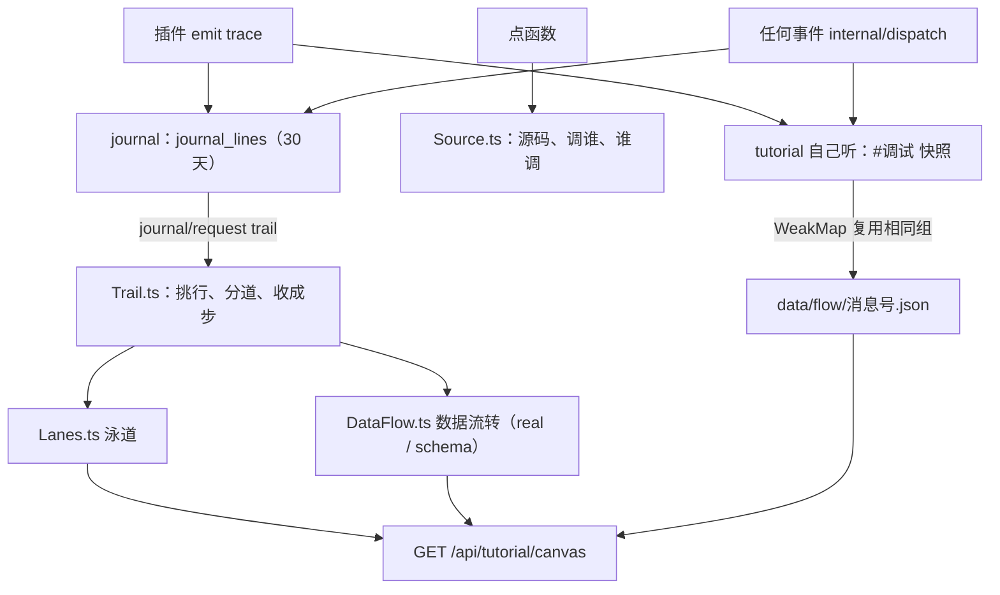

# 第十七块：教程页 tutorial 与流水账 journal：从 trace 到数据流转图

读完这一块，你能讲清楚 5 件事：

1. 一条消息走过的每一步，是谁、在什么时候记下来的，存在哪、存多久。
2. journal 和 tutorial 为什么互不 import，各自从哪拿数据。
3. 教程页的泳道画布、数据流转图、“看实现”三样东西各是怎么算出来的。
4. `#调试` 快照怎么拍下“当时每个插件里的变量”，又怎么不把内存撑爆。
5. 这两个插件里有哪些隐患和可以瘦身的地方（文末体检表）。

这是组块阅读的收官篇。读这一块之前最好先读第十一块：那一条网页消息 596 的轨迹，就是本块讲的这套机器记下、画出来的。

> 类比：**journal 是行车记录仪**，一直开着，车上每个动作（事件、跟踪点）都按时间记一行，存 30 天；**tutorial 是病历室的讲解员**，你调出某一趟的记录，它把一长串流水整理成“谁在哪一步干了什么”的图，还能翻到当时那页代码；**`#调试` 快照是拍片子**，平时不拍，你说一声“#调试”，它把这一趟每一步所有插件的状态都拍下来。

## 一图看懂

```
任何插件 ctx.emit('trace', …)    任何事件
         │                    （Cordis 先发 internal/dispatch）
         ▼                         ▼
   journal：每一行写进 journal_lines（30 天）
         │
         │  journal/request ↔ journal/result
         │   trail / boot-trail / reply-lines / query
         ▼
   journal/Trail.ts：挑行 → 按“谁发的”分道 → 收成步
         │  每步只露 FACT_KEYS 白名单里的值
         ▼
   tutorial（不 import journal）
   ├ Lanes.ts    → 泳道画布
   ├ DataFlow.ts → 数据流转图（real / schema）
   ├ Source.ts   → 看实现、它调谁、谁调它
   └ State+Snapshot → #调试 快照（自己听 trace）
         ▼
   GET /api/tutorial/canvas?name=596
```

## 一、journal：行车记录仪

### 1.1 记什么

journal 听两路，什么都记：

```ts
// src7/plugins/journal/index.ts
231	    ctx.on('trace', (where, text, code, vars) => {
```

- **跟踪点** `trace`：插件写的 `this.ctx.emit('trace', 函数名, 人话, 代码, 变量)`，记成“函数”行。
- **所有事件**：Cordis 每发一个事件，都会先发一个 `internal/dispatch`（发法、事件名、参数），journal 听它，记成“事件”行，连谁在听都记下：

```ts
// src7/plugins/journal/index.ts
262	    ctx.on('internal/dispatch', (mode, event, args) => {
263	      if (typeof event !== 'string' || event === 'trace' || event.startsWith('internal/')) return;
264
265	      //G 查询流水或用量时不写流水，重复查看不会把查询本身记成运行步骤。
266	      if (READ_EVENT_NAMES.has(event)) return;
```

- 跳过 `trace` 本身、Cordis 内部事件，以及**查流水、查用量这几个“只读”事件**（`READ_EVENTS`），不然你每打开一次教程页，流水里就多一串“有人在查流水”。

### 1.2 存哪、存多久

- SQLite 表 `journal_lines`（`data/jmbots7.db`，走 db 迁移账本建表）。
- 每行带三个“归属号”：消息号 `message_id`、会话号 `session_id`、渠道标准消息号 `source_id`。一条请求的所有行靠这三个号串起来。
- 存 30 天（配置 `events.keep_days`），每天顺手删一次过期的。库里**没有条数上限**。
- 太长的截短：文字和代码各 2000 字；变量里每个字符串 2000 字；整条变量超过 16000 字只留一个预览。

### 1.3 一条请求的账怎么挑出来

`Journal.request` 先找“收件表记下这条消息”那一行当起点（渠道来的再往前拉到渠道收到那几行），然后 `Trail.pick` 在内存里挑：

- 消息号对得上的；
- 会话号对得上的；
- 会话还没出现之前、两个号都没有的松散行（`WebApi.accept`、`bot/receive` 这些）；
- 会话变成 done / failed / stopped 之后，再收 3 秒同会话的行就停；遇到“回话写回网页”也停。

### 1.4 FACT_KEYS：页面上只露这些

```ts
// src7/plugins/journal/Trail.ts
26	const FACT_KEYS: Record<string, string> = {
27	  消息号: 'messageId',
28	  机器人: 'bot',
29	  渠道: 'channel',
30	  字数: 'length',
31	  第几步: 'step',
32	  模型: 'model',
33	  思考档: 'thinking',
```

- 一张**白名单**，共 30 项：消息号、机器人、渠道、字数、第几步、模型、思考档、状态、提示词段数、工具数……
- 只留**长度和计数**，不留“说了什么”“工具参数”“回话正文”。字符串超过 60 个字截断。
- **要分清**：白名单只管“给教程页看的步骤摘要”。`journal_lines` 表里的变量照旧存着正文（最多 2000 字），那是本机库，调试插件按项目规矩原样留。整条轨迹另带一句用户原话 `preview`，用作左栏标题。
- 键是“中文名 → 英文名”：现在的跟踪点都写英文键，中文名是老跟踪点留下的，读的时候两个都认。

> 类比：行车记录仪的原始录像（表）都在车上硬盘里；给交警看的事故摘要（FACT_KEYS）只写“几点、哪条路、车速多少”，不放车里人说的话。

## 二、两个插件为什么互不 import

- 项目规矩：**插件之间只靠事件**（CLAUDE.md）。journal 管记，tutorial 管讲，谁也不依赖谁的内部实现，拔掉一个另一个照常跑。
- 共用的东西（轨迹的形状 `Trail`、`TrailStep`，噪声事件表 `NOISE`，插件文件夹表 `FOLDERS`）放在骨架 `utils/Trail.ts`。
- tutorial 要轨迹就发一问一答 `journal/request`：

| action | 谁问 | 回什么 |
|---|---|---|
| `trail` | tutorial 画布 | 按消息号收好的一条轨迹 |
| `boot-trail` | tutorial 启动画布 | 把 tutorial 自己录的启动行收成同一格式 |
| `reply-lines` | 聊天页的回话追溯 | 到某条回话为止的流水 |
| `query` | 教程页最近消息、`GET /api/events` | 按条件查行 |
| `mirror-dir` | 要找会话镜像目录的 | 镜像目录 |

```ts
// src7/plugins/journal/index.ts
544	  requestEventModule.onRequestEvent(ctx, 'journal/request', 'journal/result', (request) => {
```

- tutorial **自己也听 `trace` 和 `internal/dispatch`**，但只为两件事：拍 `#调试` 快照、在终端打印执行路径。它不靠 journal 拍快照，journal 没挂照样能拍。
- 拍到的快照怎么和 journal 的行对上：按种类、名字、会话、消息号，加上前后 50 毫秒内（`State.ts` 的 `getMatched`）。

> 类比：记录仪厂家和讲解员是两家公司，讲解员要录像就按规矩填单子申请（`journal/request`），不去拆记录仪。

## 三、tutorial：把一长串流水讲成图

### 3.1 先收成“步”：按谁发的分道

这一步其实在 journal 的 `Trail.ts` 里做（两边共用一份）：

- 每一行看它是哪段代码发的（`site`）：`plugins/<文件夹>/` 下的就算那个插件；`Tools.ts` 算 tools，`Resources.ts` 算 resources，其余骨架算 sessions。
- 连着落在同一个插件的行，收成一步。步的标题由网页的语言包 `web/src/locales/Trace.ts` 翻成人话。

### 3.2 泳道画布：Lanes.ts

```ts
// src7/plugins/tutorial/Lanes.ts
224	export function getLanes(trail: trailModule.Trail): Lanes {
```

- 一个插件一条道，按第一次出现的先后排。
- 列：收到 → 存 → 分给机器人 → 会话第 1 步、第 2 步……（每个关口一 `session/before-model` 开一列）→ 回复。
- 启动画布另有四列：加载、服务就绪、发事件、开始监听。

### 3.3 数据流转图：DataFlow.ts

它回答的是“**每一步，哪个对象的哪个字段变成了什么**”：比如第 ② 步 `Session.row.state` 从上一轮的结果变成 running、`Session.row.messages` 多了一条。

```ts
// src7/plugins/tutorial/DataFlow.ts
119	export function buildTrailDataFlow(trail: Trail): TrailDataFlow {
```

- **两遍走完**：第一遍挨个分析每一步（Web 收件、会话、工具、bots、渠道、其它插件各一个分析函数），一个 `FlowTracker` 沿路记着会话状态、消息条数、回了几条、用的模型，所以后一步知道前一步留下了什么；第二遍把相邻两步连起来，写清“上一步交给下一步的是什么数据”。
- **real 和 schema**：每个字段都标来源。

```ts
// src7/plugins/tutorial/DataFlow.ts
1427	function pickSource(isReal: boolean): 'real' | 'schema' {
```

  - `real`：这条轨迹里**真的记到了**这个值（来自 FACT_KEYS 那些实测变量）。
  - `schema`：老轨迹没记这个值，按源码结构补上“这里应该是什么类型的数据”。这样老的轨迹也能画出完整的图，又不冒充实测。
- 网页取画布 `GET /api/tutorial/canvas?name=<消息号或 boot>` 一次拿回三样：轨迹 `trail`、泳道 `lanes`、数据流 `dataFlow`：

```ts
// src7/plugins/tutorial/index.ts
648	      const dataFlow = dataFlowModule.buildTrailDataFlow(trail);
```

### 3.4 看实现：Source.ts

点一个函数，右栏显示它的源码、它调了谁、谁调了它。

- **不用 TypeScript 编译器**，用 4 条正则认“这一行像不像函数定义”（`function`、箭头函数、类方法、对象里的方法），再自己数括号找函数结尾（跳过字符串、正则、注释）。找不到结尾最多给 80 行：

```ts
// src7/plugins/tutorial/Source.ts
85	const DEFINITION = [
```

- **“谁调它”怎么不误报**：先判断这个函数的作用域（`analyzeDefinitionScope`）：
  - `private` 的只在本文件里找；
  - 导出的顶层函数、构造函数，只在 import 了它那个文件的地方找，命名空间写法按 `别名.名字(` 认；
  - 普通类方法，要求同目录且提到了类名、或 import 了它，再匹配 `.名字(`；还认 `ctx.sessions.名字(` 这种服务写法；
  - 排除同名定义，还专门排除 SQLite 的 `.run()` 被当成 `Session.run`。
  - 例子：voice 里的 `stream.accept(pcm)` 不会算到 `WebApi.accept` 头上。
- 读过的文件一直缓存在内存里，改了源码要重启后端才看到新的。

### 3.5 启动画布：Boot.ts

- tutorial 要**写在 `plugins` 第一个**，因为 Cordis 不会补发它挂上之前的事件。
- 听 Cordis 内部的 `internal/plugin`（插件开始挂）、`internal/status`（挂好或出错）、`internal/service`（冒出新服务），算出每个插件挂了多少毫秒、新登记了哪些工具和服务；骨架四步是补记的。
- 只存内存，看的是这一次启动。

## 四、#调试 快照：拍片子，但不重复存

- 你在消息里带上 `#调试`（关键词可配置）：tutorial 在 `bot/receive` 里把关键词去掉，标记这条消息和它的会话（含子会话）。
- 这条消息的每一个事件和跟踪点，都拍一份快照：先一组 main（启动参数、进程号），再把**每个插件提供的服务读成一组**，连 private 字段都读，函数写成名字、循环引用写 `[循环]`、数据库和 Fastify 这类外部资源只写类名。
- **省内存的诀窍**在这里：

```ts
// src7/plugins/tutorial/Snapshot.ts
153	  const json = JSON.stringify(value);
154	  const old = previous.find((item) => item.name === name);
155	  if (old !== undefined && JSON_OF.get(old) === json) return old;
156
157	  const fresh = { name, note, value, notes: shown };
158	  JSON_OF.set(fresh, json);
159	  return fresh;
```

  - 每组拍完先转成 JSON，和**上一份同名组**比；一模一样就直接用旧对象，几百份快照共用同一个对象，不重复占内存。
  - JSON 字符串挂在一个 `WeakMap` 上（键是组对象）：组对象被丢掉时，这串 JSON 自动跟着回收，不用手动清。
  - 算快照总大小也只算新组的字节；比较两步差别时，同一个对象直接跳过。
- 上限：最近 500 份，总量不超过 200 MB（可配），超了从最旧的扔；回话写回后落盘成 `data/flow/<消息号>.json`，以后打开画布先读这个文件。

> 类比：拍片子时，每个部位跟上一张一模一样就不再洗新底片，直接在档案里写“同上一张”；片子太多就把最早的销毁。

## 流程图



## 按这个顺序读源码

1. `src7/plugins/journal/index.ts:228`：`listen`，记两路。
2. `src7/plugins/journal/index.ts:336`：`request`，按消息号取行。
3. `src7/plugins/journal/Trail.ts:225`：`pick`，挑出属于这条请求的行。
4. `src7/plugins/journal/Trail.ts:197`：`getFacts`，白名单。
5. `src7/plugins/tutorial/Files.ts:244`：`getMessageTrail`，tutorial 发 `journal/request` 要轨迹。
6. `src7/plugins/tutorial/Lanes.ts:224`：`getLanes`，泳道。
7. `src7/plugins/tutorial/DataFlow.ts:119`：`buildTrailDataFlow`，数据流转图。
8. `src7/plugins/tutorial/Source.ts:902`：`analyzeDefinitionScope`，“谁调它”的作用域过滤。
9. `src7/plugins/tutorial/Boot.ts:172`：`BootTrail`，启动画布。
10. `src7/plugins/tutorial/Snapshot.ts:41`：`JSON_OF`，快照复用。

## 自测

1. 你打开一次教程页，流水表里会不会多出一串“教程页在查流水”的记录？

<details><summary>参考答案</summary>

不会。journal 写流水时跳过 `READ_EVENTS` 里的只读事件（`journal/request`、`journal/result`、用量查询那两个），查询本身不算运行步骤。

</details>

2. 教程页步骤里能看到用户说的原话和机器人的回答正文吗？

<details><summary>参考答案</summary>

步骤摘要看不到：每步只露 `FACT_KEYS` 白名单里的值，都是长度、计数、状态、模型这类，不含正文，字符串还截到 60 字。整条轨迹会带一句用户原话 `preview` 当标题。原始的 `journal_lines` 表里变量仍存着正文（最多 2000 字），那是本机库。

</details>

3. 数据流转图里一个字段标着 `schema`，是什么意思？

<details><summary>参考答案</summary>

这条轨迹里没有真的记到这个值（多半是老轨迹，那时跟踪点还没带这个变量），DataFlow 按源码结构补上“这里应该是什么数据”，标 `schema` 表示是推出来的；真记到的标 `real`。

</details>

4. 一条 `#调试` 消息走了 40 步，每步都拍了十几个插件的状态，为什么内存没爆？

<details><summary>参考答案</summary>

大部分插件在这一步和上一步一模一样。`Snapshot.ts` 每组先转 JSON 和上一份同名组比，相同就直接复用旧对象；JSON 字符串挂在 `WeakMap` 上随对象回收。再加上最多 500 份、总量 200 MB 的上限，超了从最旧的扔。

</details>

## 本块源码深度体检

每条都对过源码；“待核”是没把握是不是有意这么写。

| # | 位置 | 问题 | 改法 |
|---|---|---|---|
| 1 | `journal/index.ts:538` | 先调一次 `pick` 拿挑中的行，紧接着 `getTrail` 里又调一次 `pick`，同样的挑行算两遍 | `getTrail` 顺带交回挑中的行，或把它传进去 |
| 2 | `journal/index.ts:263` | “跳过 trace 和内部事件”在 journal、tutorial 的 `State.ts`、`Print.ts` 各写一份；journal 写库时不跳 `NOISE`（如网页状态轮询），这些行可能占掉不少库（待核数量） | 收成 `utils/Trace.ts` 一个函数；考虑写入时就跳过 `NOISE` |
| 3 | `journal/index.ts:232` | “英文键 ?? 中文键”的双读散在 journal、`Trail.ts`、`State.ts` 十几处，没写退场条件 | 抽一个取变量的小函数；老中文跟踪点清完后按 `//退场：` 删中文那一半 |
| 4 | `journal/Trail.ts:74` | 旧事件名映射表（13 项）没写退场条件；库只存 30 天，旧名早该不在库里了 | 标 `//退场：keep_days 过后库里没有旧事件名`，到期删 |
| 5 | `journal/index.ts:217` | 表走了迁移账本，但四个索引还是手写 `exec`，不在账本里 | 加一版迁移写这四个索引，删掉手写的 |
| 6 | `journal/FilesMirror.ts:72` | 每个会话记一项，从不删，长期运行跟着会话数涨（每项很小） | 会话结束一段时间后删，或用定长 LRU |
| 7 | `tutorial/Files.ts:332` | 快照文件直接 `writeFile`，不是原子写；写到一半被读到会是坏 JSON（journal 的镜像用的是原子写） | 改用 `utils/Files.ts` 的原子写 |
| 8 | `tutorial/Source.ts:570` | “谁调它”每次点都把全仓每一行扫一遍，没缓存；读过的文件一直缓存、不按修改时间失效 | 按“文件 + 函数名”缓存结果，文件改了按修改时间失效 |
| 9 | `tutorial/Source.ts:1054` | 写死了 `Session` 的特判和一串变量名（session、front、work……）；正则解析 TypeScript，多行签名、模板字符串嵌套时可能错配（待核误判率） | 特例抽成一张表；长远换 TypeScript 的语法树 |
| 10 | `tutorial/DataFlow.ts:556` | 约 270 行，一个函数里分别处理 running、用户话、工具结果、关口一等多种事件；`DataFlow.ts` 全文 1437 行 | 每种事件拆成一个小函数，用表分发 |
| 11 | `tutorial/DataFlow.ts:22` | 骨架名单在这里、`Lanes.ts` 的 `SKELETON_SERVICES`、`Skeleton.ts` 各写一份（还不一样，`Lanes.ts` 少 main）；变量说明表 `FACT_NOTES` 在 `DataFlow.ts` 和 `Boot.ts` 各一张 | 从 `Skeleton.ts` 的 `SKELETON_SPECS` 派生，全局共用一份 |
| 12 | `journal/Trail.ts:14` | 后端插件直接 import 网页目录的语言包；编后端 exe 时会把网页代码一起拉进来，两边耦合 | 把翻译表挪到 `src7/` 共享目录，网页和后端都从那里取 |

下一块：待定（中控登记总览时填）。
